<div align="center">

<picture>
  <source media="(prefers-color-scheme: light)" srcset="media/banner-light.svg">
  
</picture>

**A native Markdown notes application for Linux, written in Rust. It opens an Obsidian vault as it is.**

[](https://github.com/didntchooseaname/focus/actions/workflows/ci.yml)
[](https://github.com/didntchooseaname/focus/releases/latest)
[](LICENSE)
[](Cargo.toml)
[](#state-of-the-project)
[](#state-of-the-project)
[](#languages)

</div>

<picture>
  <source media="(prefers-color-scheme: light)" srcset="media/hero-light.png">
  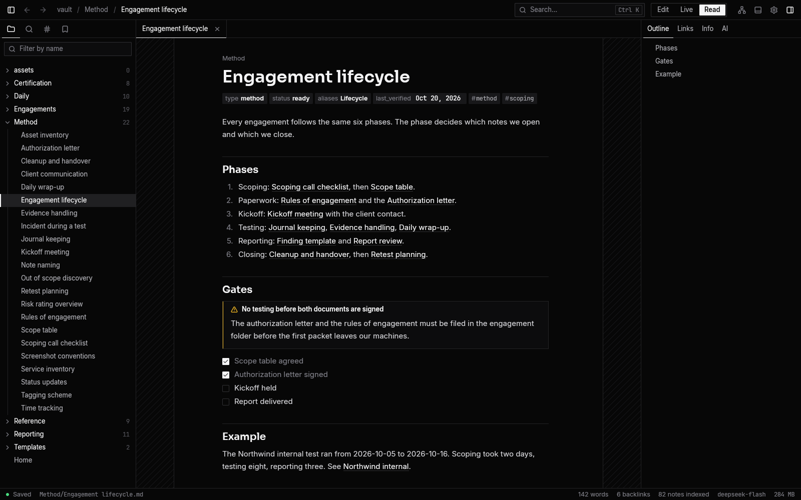
</picture>

Focus reads a folder of Markdown notes without converting it, so the vault stays usable in Obsidian. It adds an indexed full-text search, a vault graph, an assistant that talks to the DeepSeek API, an MCP server that lets an agent work on the vault, and an optional mode for penetration test engagements. The interface is drawn in black and white with GPUI, without a web view.

## Performance

Measured on 2026-11-15: the application and the measuring programs are the release build of commit f586837; on an AMD Ryzen 7 5800X 8-Core Processor (16 logical cores) with 31,990 MiB of memory, Linux 7.2.14-arch1-1, Hyprland and an NVIDIA GeForce RTX 3070. The run took 2,346 s. The load average at the start was 1.60, 1.20, 1.79 over 1, 5 and 15 minutes; a run counts as loaded above 4 on the one minute figure (`loaded`: false).

The vaults are generated with a fixed seed: notes of 0.5 to 4 KB with frontmatter, tags, links, headings, code blocks and tasks, 1.5, 15.5 and 155.5 MiB of Markdown for 1,000, 10,000 and 100,000 notes. The page cache of the system was warm. To measure again: `tools/bench/run.sh --full`.

<picture><source media="(prefers-color-scheme: light)" srcset="media/bench-search-light.svg">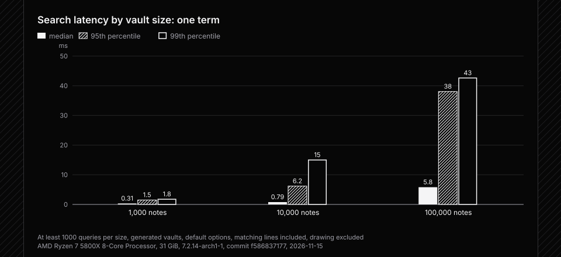</picture>

<picture><source media="(prefers-color-scheme: light)" srcset="media/bench-startup-light.svg">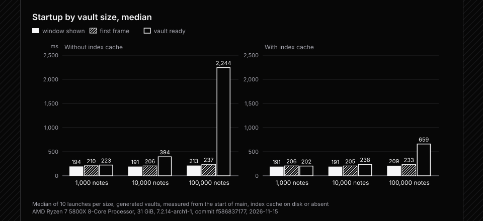</picture>

<picture><source media="(prefers-color-scheme: light)" srcset="media/bench-latency-light.svg">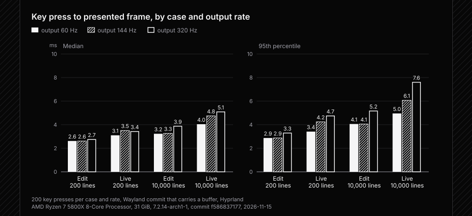</picture>

### Search

| Query | 10,000 notes | 100,000 notes |
|---|---:|---:|
| One term | 0.79 / 6.2 / 15.0 | 5.8 / 38.1 / 42.6 |
| Two terms | 0.63 / 1.2 / 2.3 | 3.9 / 8.2 / 14.1 |
| Exact phrase | 0.94 / 7.1 / 8.4 | 10.7 / 40.3 / 40.5 |
| Tag filter | 2.7 / 5.9 / 6.7 | 32.6 / 72.0 / 88.9 |
| Path filter and a term | 0.86 / 2.1 / 3.7 | 6.7 / 13.6 / 27.1 |
| No result | 0.16 / 0.27 / 0.35 | 0.93 / 1.3 / 1.6 |
| Full-text search, each keystroke of a word | 1.4 / 22.7 / 25.1 | 12.6 / 47.4 / 48.0 |
| Palette, each keystroke of a name | 0.09 / 0.50 / 0.58 | 0.47 / 1.8 / 2.0 |

Milliseconds, median / 95th percentile / 99th percentile, from at least 719 samples per cell. The measured call is `SearchIndex::search` with its default options (at most 500 notes and 20 matching lines per note, a 40 ms verification budget), including the matching lines a result panel draws; drawing is not measured. At 1,000 notes the one term search takes 0.31 / 1.5 / 1.8 ms.

### Startup

| From the start of `main` to | 1,000 notes | 10,000 notes | 100,000 notes |
|---|---:|---:|---:|
| Window shown, no index cache | 194 / 235 | 191 / 206 | 213 / 224 |
| Vault ready, no index cache | 223 / 262 | 394 / 405 | 2,244 / 2,300 |
| Window shown, index cache present | 191 / 198 | 191 / 231 | 209 / 218 |
| Vault ready, index cache present | 202 / 219 | 238 / 277 | 659 / 670 |

Milliseconds, median / 95th percentile, 10 launches per cell. Vault ready means the tree is shown and search is usable. Opening the vault and the index alone takes 448 ms with the cache and 2,033 ms without at 100,000 notes. Building the index from nothing takes 1,457 ms (53,690 notes per second, 83.5 MiB per second); the cache takes 111 MiB on disk.

### Memory

| MiB, median | 1,000 notes | 10,000 notes | 100,000 notes |
|---|---:|---:|---:|
| Private (anonymous) memory, one note open | 76.7 | 110 | 446 |
| Private (anonymous) memory, five notes in tabs | 87.3 | 128 | 539 |
| Proportional set size (PSS), one note open | 190 | 223 | 562 |
| Part of the PSS that belongs to the graphics driver mappings | 85.7 | 85.7 | 85.7 |

Read from `/proc/<pid>/smaps_rollup` 5 s after the vault is open, five runs per cell; the graphics driver mappings are summed from `/proc/<pid>/smaps` and are kept apart: they are 85.7 MiB at every vault size.

### At rest

| Over 30 s, medians of 3 runs | 60 Hz output | 144 Hz output | 320 Hz output |
|---|---:|---:|---:|
| Note shown, nothing focused: frames drawn, 30 s | 0 | 0 | 0 |
| Note shown, nothing focused: voluntary context switches, 30 s | 200 | 200 | 200 |
| Note shown, nothing focused: processor time (ms), 30 s | 40 | 50 | 60 |
| Editor focused, caret visible: frames drawn, 30 s | 59 | 59 | 59 |
| Editor focused, caret visible: voluntary context switches, 30 s | 317 | 317 | 317 |
| Editor focused, caret visible: processor time (ms), 30 s | 170 | 170 | 170 |

A frame drawn is a frame callback asked of the compositor (`wl_surface.frame`). With a note shown the window draws 0 frames per second at the three output rates; with the editor focused it draws 2 per second (59 in 30 s), the blinking caret.

### Typing and scrolling

| Median / 95th percentile, ms | 60 Hz output | 144 Hz output | 320 Hz output |
|---|---:|---:|---:|
| Key press to presented frame, Edit, note of 200 lines | 2.6 / 2.9 | 2.6 / 2.9 | 2.7 / 3.3 |
| Key press to presented frame, Live, note of 200 lines | 3.1 / 3.4 | 3.5 / 4.2 | 3.4 / 4.7 |
| Key press to presented frame, Edit, note of 10,000 lines | 3.2 / 4.1 | 3.3 / 4.1 | 3.9 / 5.2 |
| Key press to presented frame, Live, note of 10,000 lines | 4.0 / 5.0 | 4.8 / 6.1 | 5.1 / 7.6 |
| Interval between presented frames, continuous scroll of the 10,000 line note | 16.6 / 17.3 | 7.0 / 7.6 | 4.0 / 6.5 |
| Open the 10,000 line note | 21.4 / 21.5 | 21.4 / 21.8 | 21.7 / 22.4 |

200 key presses per case and rate, 1.5 s of rest before each. The time is taken from the Wayland debug stream, from the key to the next commit that carries a buffer; reading that stream slows the client a little. The scroll presents one frame per period of the output at 60 Hz and 144 Hz, with no interval longer than two periods.

### Graph, binaries and agent server

| Median | 1,000 notes | 10,000 notes | 100,000 notes |
|---|---:|---:|---:|
| Graph of the notes: build | 1.0 ms | 7.0 ms | 97.5 ms |
| Graph of the notes: layout until stable | 43.0 ms | 388 ms | 3,754 ms |
| Graph: update after editing a hub note | 0.10 ms | 0.60 ms | 8.1 ms |
| Index: update until a new term is found | 3.0 ms | 6.3 ms | 51.3 ms |
| Rename a note and rewrite its links | 19.3 ms | 31.2 ms | 179 ms |
| `focus-mcp`: start to first answer | 11.0 ms | 89.0 ms | 971 ms |

The `focus` binary is 44.1 MiB and `focus-mcp` 9.0 MiB (`stat`, stripped release build). The graph layout figures come from `graph_bench`, which rounds to the millisecond.

### What is slower

- A key press in a note of 10,000 lines takes 3.2 to 5.1 ms at the median, against 2.6 to 3.5 ms for a note of 200 lines; the 95th percentile reaches 7.6 ms (Live at 320 Hz).
- At 320 Hz, continuous scrolling of that note presents a frame every 4.0 ms at the median, about 253 frames per second for a period of 3.1 ms; 300 of 4,216 intervals last more than two periods, the longest 22.3 ms.
- At 100,000 notes the application holds 446 MiB of private memory with one note open and 539 MiB with five tabs, against 76.7 MiB at 1,000 notes.
- The tag filter takes 32.6 / 72.0 / 88.9 ms (median / 95th / 99th percentile) at 100,000 notes; one term takes 5.8 / 38.1 / 42.6 ms.
- Typing in the full-text search costs 12.6 / 47.4 ms per keystroke (median / 95th percentile) at 100,000 notes; the palette costs 0.47 / 1.8 ms.
- Without the index cache, a vault of 100,000 notes is ready after 2,244 ms at the median and 2,300 ms at the 95th percentile, against 659 ms with it. At 1,000 notes without the cache the 95th percentile is 262 ms for a median of 223 ms.
- The layout of the graph takes 3,754 ms to settle at 100,000 notes.

### Not measured

- Cold page cache: dropping it needs root.
- Other machines, other output rates and other platforms: this is one machine and one run.
- Search with typo tolerance in full text: the query language has none; only the palette matches approximately.
- Graph steps under a millisecond.
- Any other application: nothing here is compared with one.

## Screenshots

All images are taken with `tools/shot.sh` on a copy of `fixtures/demo-vault`, an invented vault of 82 notes in English (a penetration test team's method notebook and one demonstration engagement), in 1600 x 1000 pixels. They are produced by `tools/shots/readme/run.sh`.

| | |
|---|---|
| 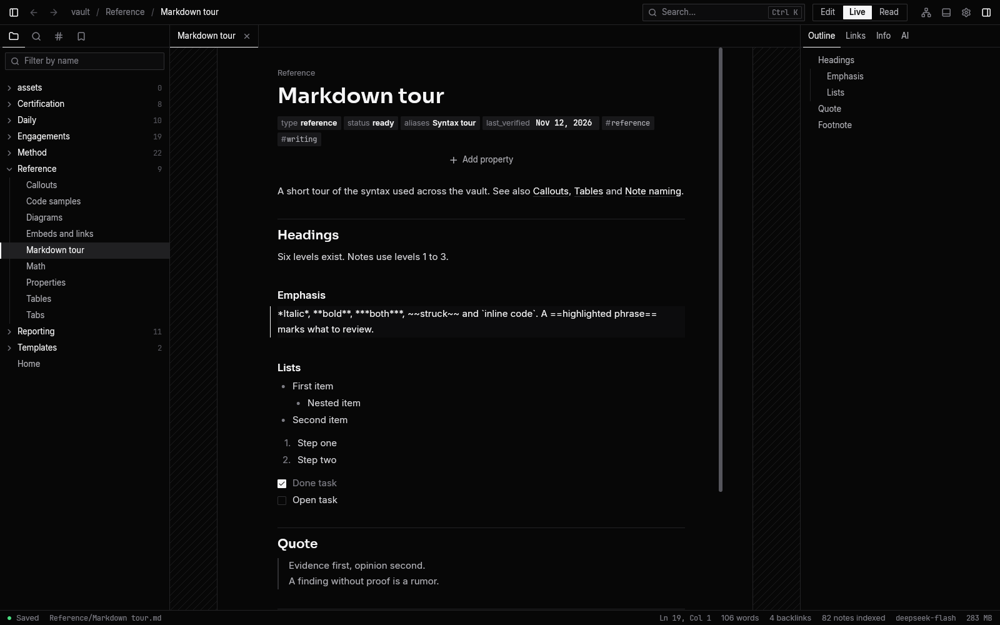 | 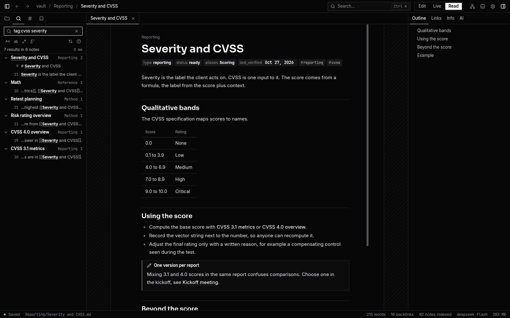 |
| Live view: a click opens the Markdown source of one block. | Search: operators, results grouped by note. |
| 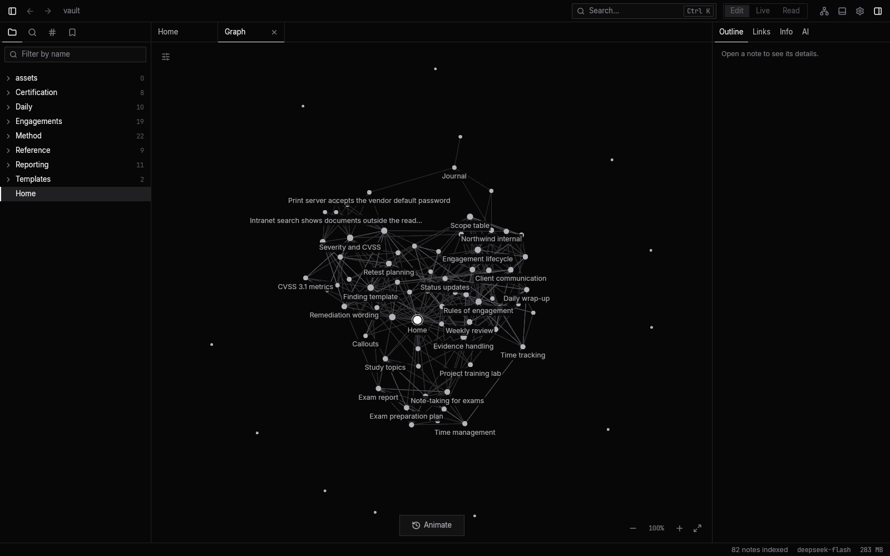 | 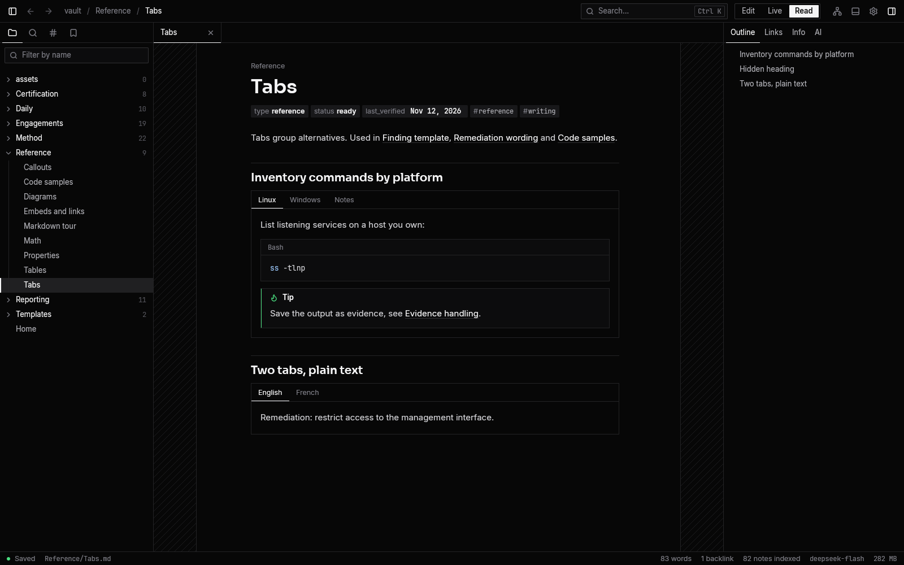 |
| The graph of the vault. | Tabs inside a note. |
| 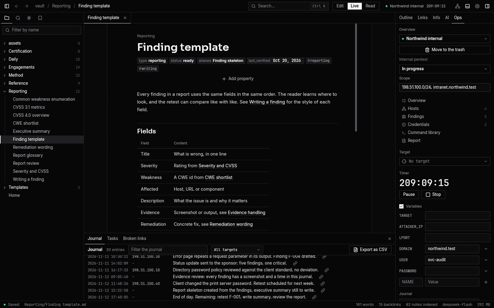 | 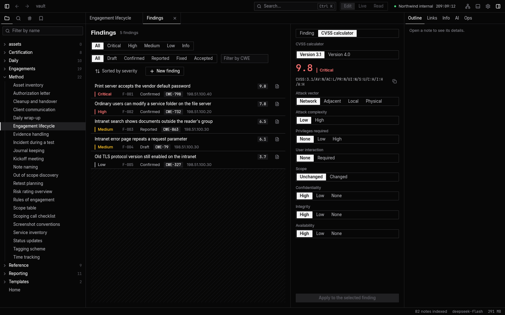 |
| Ops mode: engagement, variables resolved in the code blocks of any note, journal. | Findings with the CVSS 3.1 and 4.0 calculator. |
| 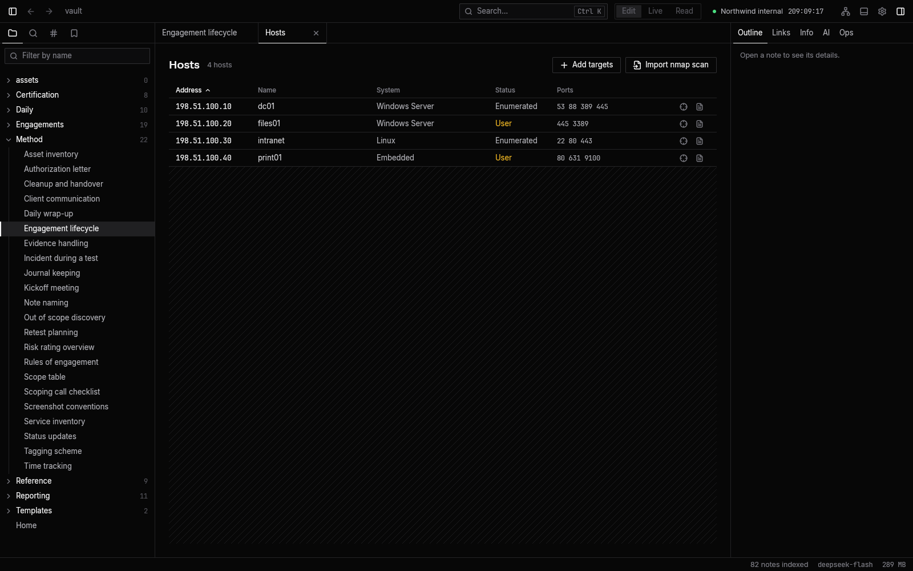 | 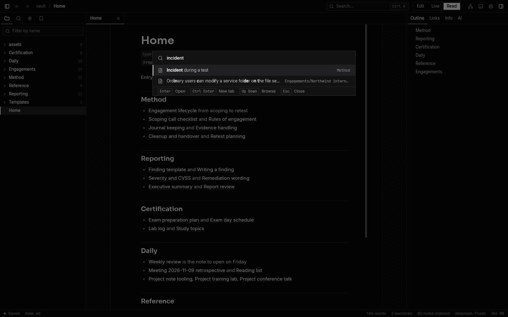 |
| Hosts, with nmap import. | The palette: notes and commands. |
| 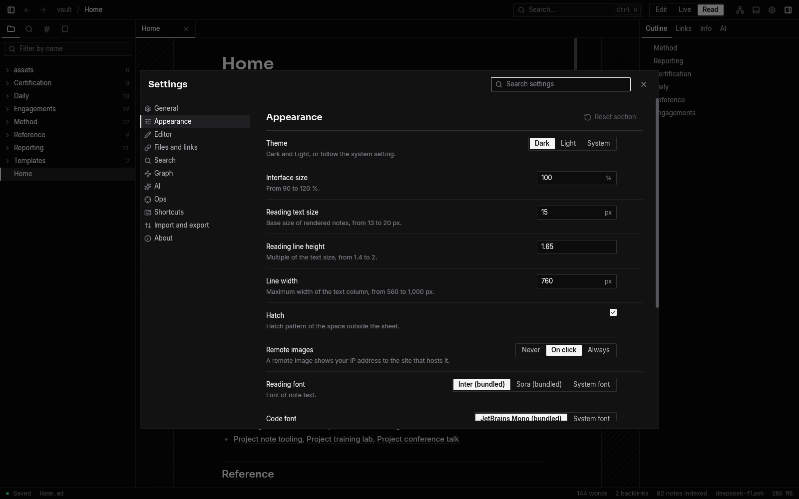 | 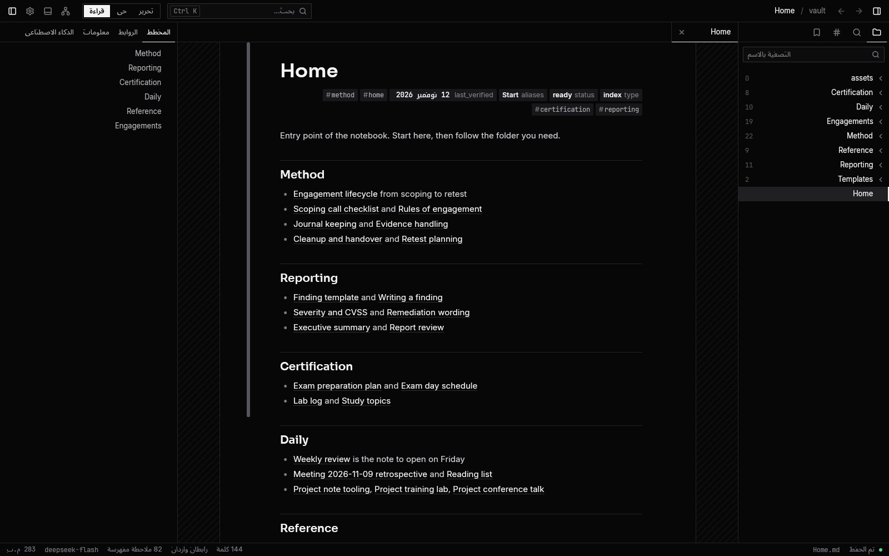 |
| Settings. | Arabic: mirrored layout; the direction of a paragraph follows its first strong character. |
| 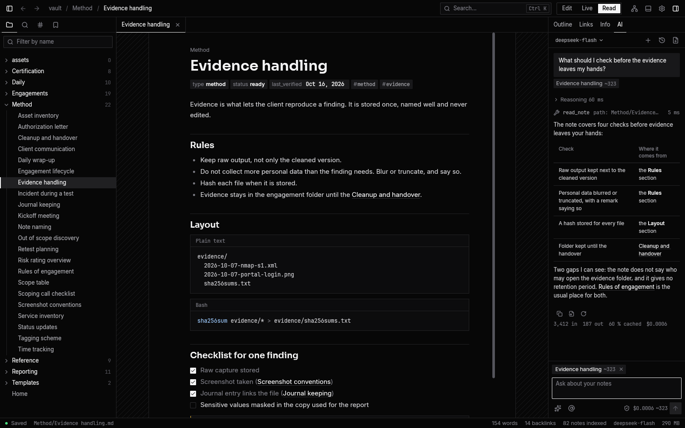 | |
| The AI panel with a scripted client (no network): the context chip, the tool call and a streamed answer. | |

## What Focus does

- **Notes and Obsidian compatibility.** Opens a vault folder as it is: wiki links and Markdown links with Obsidian's resolution rules, embeds, callouts, footnotes, tags, `%%comments%%`, frontmatter, Mermaid, tabs and `<details>`, and Obsidian Bases (`.base`) as tables. Writes are atomic, autosaved 800 ms after the last key, and an external change to an open note is detected.
- **Views, tabs and groups.** Live, the default (the note is rendered, and a click on a block shows the source of that block), Edit (Markdown source) and Read. Tabs sit in one group or two side by side (`Ctrl \`); a note open in both groups is one document. Tabs, groups and widths are restored at launch.
- **Note history.** Before a write replaces a note, the previous content is kept as a version if the last one is more than 5 minutes old, outside the vault (`~/.local/share/focus/history/`, 14 days and 200 MB per vault by default). "Versions" compares a version with the current text and restores it.
- **Files.** Focus is offered in the "Open with" menu of a file manager for Markdown files and folders; a file outside any vault opens as a loose note, saved in place. Files and folders dropped on the tree, or pasted into it after a copy in a file manager, are copied into the vault without overwriting anything. `Ctrl C` in the tree puts notes and folders on the clipboard for a file manager, and an item dragged out of the tree is copied to the application under the pointer (Wayland only).
- **Search.** A persistent trigram index with `"phrase"`, `a OR b`, `-excluded`, `/regex/`, `tag:`, `path:`, `file:`, `title:`, `heading:`, `task:` and `prop:`, replace across the vault, and a fuzzy palette (Ctrl K).
- **Graph.** The whole vault, and a local graph in the right bar.
- **Assistant.** DeepSeek, OpenAI, Anthropic, Ollama, LM Studio, vLLM or any server of the OpenAI chat completions format, with streaming, reasoning, tool calls and assisted search. Secrets are masked before anything is sent, the context sent is shown as chips, and every write proposed by the assistant waits for confirmation. One switch in the settings turns every AI feature off.
- **MCP server and agents.** `focus-mcp` serves the vault to Claude Code, Codex CLI, Gemini CLI, Cursor and other clients, read only by default.
- **Ops mode.** Engagements and certification exams stored as Markdown (external, internal, web, red team, lab and exam), with a timer that can be paused. Hosts from an nmap scan, a text or CSV file, a paste or by hand, each with its proofs and flags. Findings with CVSS 3.1 and 4.0 calculators and CWE identifiers, edited in place. Credentials that can set the variables, a timestamped journal, checklists, and a command library taken from the code blocks of your own notes, with variables in the Exegol convention resolved in any note. Reports are assembled in Markdown, HTML and PDF, and an engagement exports to SysReptor.
- **Platforms.** Wayland and X11 in one binary, chosen at run time.
- **Import and export.** Import of `.md`, `.txt`, `.html`, folders, zip archives and Notion exports. Export of a note to standalone HTML, Markdown and PDF, and of a folder or a vault to zip.
- **Languages.** English, French, Arabic (mirrored layout) and Simplified Chinese; a folder of your own translations can add or replace texts.

## State of the project

Checked on 2026-11-15 by running the release build of f586837 from `tools/shot.sh` on a virtual Wayland output: 23 scripted runs, among them typing, Live editing, undo, tab groups, note versions, files from outside, open with, fullscreen, Ops dialogs and variables, and scrolling.

Looked at in the screenshots above: the file tree, note tabs, Read and Live views, search, the graph, the Ops sidebar and journal panel, the settings window and the mirrored Arabic layout. The other features are covered by the tests of each crate.

Not verified:

- X11 was never launched. The binary contains both backends, and the code that sets the window class was read but not run.
- No AI provider was called with a real key or server. The clients are tested against a local test server, and the AI panel was run with a scripted client only.
- Dragging an item out of the tree was not run against a compositor: the scripted runs inject their events into the application, and none holds a real button.
- Fullscreen under Hyprland on a physical screen: the run passes on the virtual output only.
- The Arabic and Chinese translations are not reviewed by native speakers.
- A second user account, a locked or missing system keyring, the PDF export, the download of remote images and the zip import of a hostile archive were not tested.

Every push runs `.github/workflows/ci.yml`: formatting, clippy with warnings denied, the tests of the workspace, the text checks of `tools/check.sh`, a dependency audit and a type check of both Windows targets. The scripted interface runs need a Hyprland session and stay on the development machine. The Windows builds were never started on Windows.

## Install

Each [release](https://github.com/didntchooseaname/focus/releases/latest) carries four files, `SHA256SUMS.txt` and its signature:

| System | File | Use |
|---|---|---|
| Linux x86_64 | `Focus-<version>-x86_64.AppImage` | `chmod +x` the file and run it |
| Linux x86_64 | `focus-<version>-linux-x86_64.tar.gz` | `focus`, `focus-mcp`, the desktop entry and the icon, to install as shown under "Build and run" |
| Windows x64 | `focus-<version>-windows-x64.zip` | `focus.exe` and `focus-mcp.exe`, unsigned |
| Windows 11 on ARM64 | `focus-<version>-windows-arm64.zip` | the same, for ARM64 |

The Linux files are built on Ubuntu 22.04 and need glibc 2.35 or newer, a Wayland compositor or an X server and a Vulkan capable driver. The AppImage carries libxkbcommon; fontconfig and the Vulkan loader come from the system. `focus --version` prints the version.

A release is published from `main` when the commits since the last one hold a feature, a fix, a performance change or a breaking change; its number comes from those commit types (`tools/release.py`).

`SHA256SUMS.txt.minisig` is the [minisign](https://jedisct1.github.io/minisign/) signature of the list of sums, made with the key of `assets/release.pub`. To check a download by hand:

```
minisign -Vm SHA256SUMS.txt -p assets/release.pub
sha256sum --check --ignore-missing SHA256SUMS.txt
```

### Updates

Focus can offer its own updates. The first launch asks, the answer is off until you say yes, and Settings › General › "Offer updates" changes it. When on, Focus asks GitHub for the latest release 10 seconds after launch and every hour, and shows a banner with the running version, the new one, a link to the release notes and "Download". The release is offered only if its list of sums carries a valid signature of the release key; "Download" fetches the file of the package you run (the AppImage, the Linux archive, the Windows zip of your architecture), checks it against that list, replaces `focus` and `focus-mcp` where they are, and offers to restart. Nothing is replaced when a check fails. Where Focus cannot write its own folder, the banner says so and the release page has the files.

## Build and run

Focus needs a Rust toolchain that supports edition 2024 (rustc 1.99.1 was used) and the development files of fontconfig, libxcb, libxkbcommon and libxkbcommon-x11 with `pkg-config`. At run time it needs a Wayland compositor or an X server and a Vulkan capable driver. The package names depend on the distribution; the list comes from the dependency tree in `Cargo.lock` and from `ldd` on the binary.

```
cargo build --release -p focus -p focus-mcp
target/release/focus --vault <path to a vault>
```

The first build of the GPUI dependencies took 16 min 24 s with `-j 3` on the development machine (2026-11-12). Without `--vault`, Focus reopens the last vault it remembers, or shows the language and vault screens. `focus obsidian://open?vault=Work&file=Plan` follows an Obsidian address in the open vault (in the window already running, if any); one that writes asks first. `focus --capture "text"` (or `--capture -` to read the standard input) appends a line to the capture note of the settings, today's note by default, through the running window without raising it, or directly in the vault opened last; it opens no window, prints where the line went on the standard error and exits with 0 when written, 1 when the write failed and 2 when there was nothing to write or no vault. Focus does not register itself for `obsidian://` addresses. To choose it, write a desktop entry such as `~/.local/share/applications/focus-obsidian.desktop` with `Exec=focus %u`, `MimeType=x-scheme-handler/obsidian;` and `NoDisplay=true`, then run `xdg-mime default focus-obsidian.desktop x-scheme-handler/obsidian`. `./install-desktop.sh [vault]` registers a desktop entry for the built binary. To install by hand, with `focus.desktop` as a template that expects `focus` on the `PATH`:

```
install -Dm755 target/release/focus ~/.local/bin/focus
install -Dm644 assets/icons/focus.png ~/.local/share/icons/hicolor/256x256/apps/focus.png
install -Dm644 focus.desktop ~/.local/share/applications/focus.desktop
```

| Variable | Effect |
|---|---|
| `FOCUS_CONFIG_DIR` | settings folder; in script mode the only place settings are read and written |
| `FOCUS_CACHE_DIR` | root of the per-vault caches (default `$XDG_CACHE_HOME/focus`) |
| `DEEPSEEK_API_KEY` | API key; wins over the keyring and the key file |
| `FOCUS_PROFILE=1` | prints start-up timings |

Optional programs: a Chromium based browser on the `PATH` for PDF export, and `secret-tool` to keep the API key in the system keyring.

Tests and checks:

```
cargo test -j 3 -p focus-core -p focus-search -p focus-md -p focus-ai -p focus-ops -p focus-i18n -p focus-mcp
cargo clippy --all-targets -j 3
```

## Getting started

Open a folder with `--vault`, or pick one on the first launch screen. Focus writes to the vault only on an action of yours and creates nothing in it when it opens. Settings are in `~/.config/focus/`, caches in `~/.cache/focus/`, conversations and note versions in `~/.local/share/focus/`. Press `Ctrl K` and type a note name or `>` for a command.

| Shortcut | Action |
|---|---|
| `Ctrl K`, `Ctrl P`, `Ctrl O` | open the palette |
| `Ctrl Shift P` | open the palette on commands |
| `Ctrl Shift F` | search the vault |
| `Ctrl E` | switch between editing and reading |
| `Ctrl B`, `Ctrl Alt B`, `Ctrl J` | left bar, right bar, bottom panel |
| `Ctrl ,` | settings |
| `Ctrl Tab` | next tab |
| `Ctrl \` | split right: the note goes to the other group of tabs |
| `/` | slash menu in the source editor |

The full list is in `locales/en/templates/help/keyboard-shortcuts.md`.

## Connect an agent

`focus-mcp` is a program without interface that speaks the Model Context Protocol on standard input and output:

```
focus-mcp --vault <path> [--write]
```

The help note "Connect an agent to Focus" (Help menu) gives the command for each client. A Claude Code skill is in `assets/skill/`.

## Security

Focus has no telemetry and makes no network call at start unless you turned update offers on: it then requests the list of the latest release from GitHub, with no identifier. Provider keys stay in the environment or the system keyring (the DeepSeek key may also be in a file of mode 0600), never in the settings. Writes proposed by the assistant wait for confirmation.

## Architecture

Service crates have no dependency on GPUI.

| Crate | Role |
|---|---|
| `focus-core` | the vault: disk walk, note metadata, links, watching, atomic writes, attachments, settings file |
| `focus-search` | trigram index, query language, fuzzy matching |
| `focus-graph` | graph construction and force layout |
| `focus-md` | the Markdown dialect, Mermaid, highlighting, HTML, Markdown, PDF and zip export, import |
| `focus-bases` | table views of Obsidian Bases |
| `focus-ai` | DeepSeek client, secret masking, key storage, conversations, MCP client |
| `focus-ops` | engagements, hosts, findings, CVSS, journal, checklists, exam profiles |
| `focus-mcp` | the vault tools shared by the assistant and the `focus-mcp` program |
| `focus-i18n` | Fluent translations, language, direction, number and date formats |
| `focus-update` | latest release, signature and checksum verification, replacement of the programs in place |
| `focus-kit` | design tokens, embedded fonts, icons, base components, mirroring helpers |
| `focus-view-*` | reading, search, graph, AI, Ops, transfer and vault screens |
| `app` | the `focus` binary: window, shell, tabs, editor, palette, settings |

## Languages

English is the default and the fallback. French, Arabic and Simplified Chinese are complete in the interface, and the Arabic and Chinese texts are not reviewed by native speakers. Texts live in `locales/<language>/<domain>.ftl`; a test fails when a language lacks a key or a variable that English has. A folder `~/.config/focus/locales/<language>/` completes or replaces them. Chinese uses the installed CJK font.

## Documentation

The help notes of the application are in `locales/<language>/templates/help/`; the Help menu opens them.

## Third party components

Fonts, icons and the vendored crates (GPUI 0.2.2, gpui-component 0.5.1, mermaid-rs-renderer 0.3.1, proc-macro-error2 2.0.1, each with its patches in `FOCUS-PATCHES.md`) are listed with their licenses in [NOTICE](NOTICE).

## License

Copyright (C) 2026 The Focus authors.

Focus is free software: you can redistribute it and/or modify it under the terms of the GNU Affero General Public License as published by the Free Software Foundation, either version 3 of the License, or (at your option) any later version. It is distributed without any warranty. The text is in [LICENSE](LICENSE). Third party components keep their own licenses, listed in [NOTICE](NOTICE).

The authors reserve the use of this repository for text and data mining, including the training of machine learning models, under Article 4(3) of Directive (EU) 2019/790. This is a statement of the rights holders, not a term of the license.
