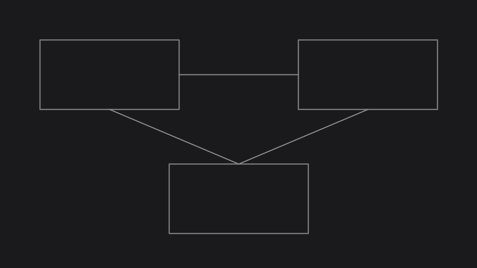

# Reading

A paragraph with a footnote[^short] and a longer one[^long]. Links go to [[Target]], to a [[Target#Second section|section]], to a [[Missing note]] and to [the web](https://example.org). Tags such as #demo/reading are links too.

## Tables

| Port | Service | Version | Hosts | Notes |
| ---: | --- | --- | ---: | --- |
| 22 | ssh | OpenSSH 8.9p1 | 5985 | Key based login only, password authentication disabled on every host of the range |
| 445 | microsoft-ds | Windows Server 2019 | 12 | SMB signing not required |
| 5985 | wsman | Microsoft HTTPAPI httpd 2.0 | 3 | WinRM open to the whole subnet |

| Key | Value |
| --- | --- |
| Engagement | ACME internal |
| Window | 2026-11-12 to 2026-11-19 |

| Host | IP | OS | Domain | Role | Owner | Criticality | First seen | Last seen | Open ports | Findings |
| --- | --- | --- | --- | --- | --- | --- | --- | --- | --- | --- |
| dc01 | 10.10.10.5 | Windows Server 2019 | acme.local | Domain controller | IT operations | Critical | 2026-11-12 | 2026-11-14 | 53, 88, 135, 389, 445, 5985 | 4 |
| web01 | 10.10.10.20 | Ubuntu 22.04 | acme.local | Intranet | Web team | High | 2026-11-12 | 2026-11-13 | 22, 80, 443 | 2 |

## Code

```python
def greet(name: str) -> str:
    return f"Hello {name}"
```

```
plain text without a language
second line
```

## Embeds

![[Target]]

![[Target#Second section]]

![[Target^key-point]]

![[Loop]]

## Image

<figure><figcaption>Network map of the lab, drawn by hand</figcaption></figure>

## Sections

### Folded later

Some text under a third level heading.

- one
- two
- three

[^short]: A short footnote.
[^long]: A footnote with **bold** text, a link to [[Target]] and a list:
    - first item
    - second item
