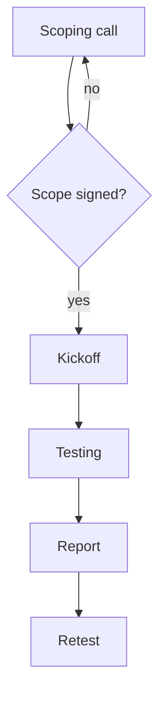
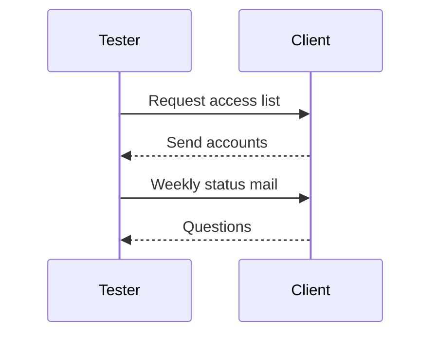
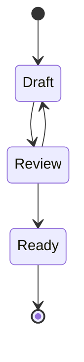
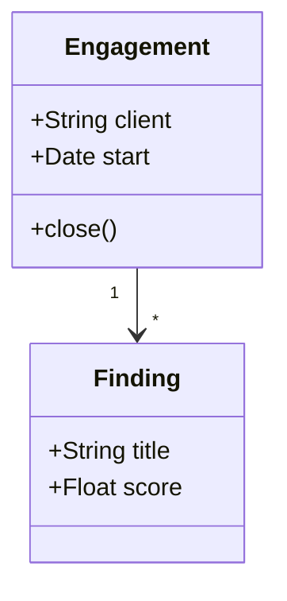
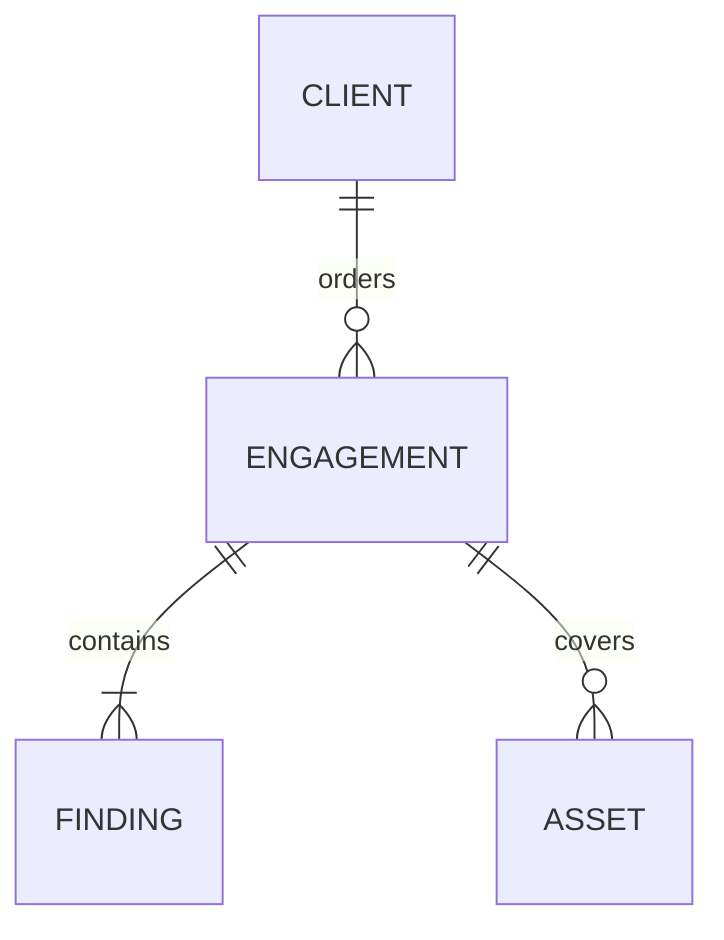
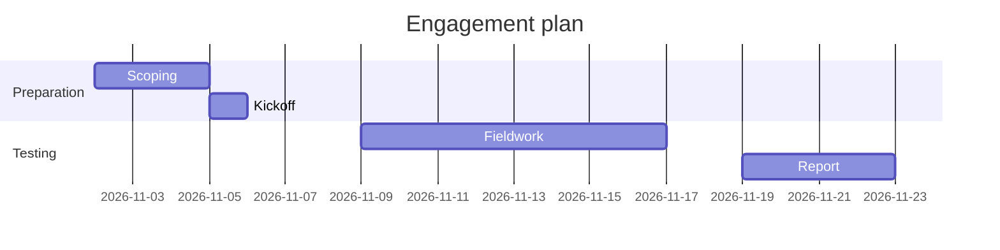
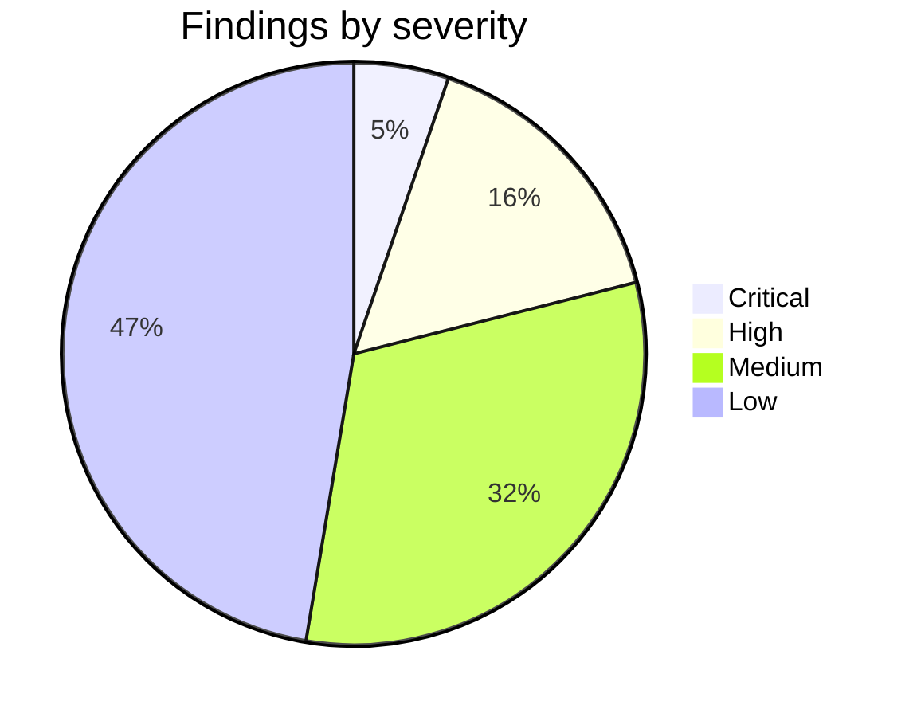
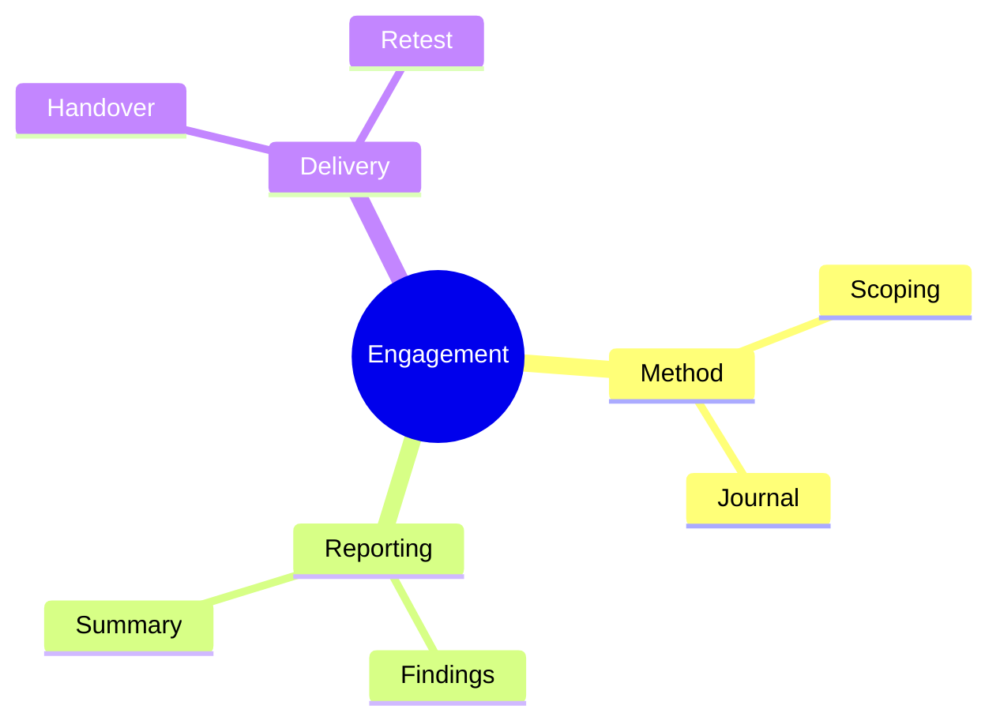
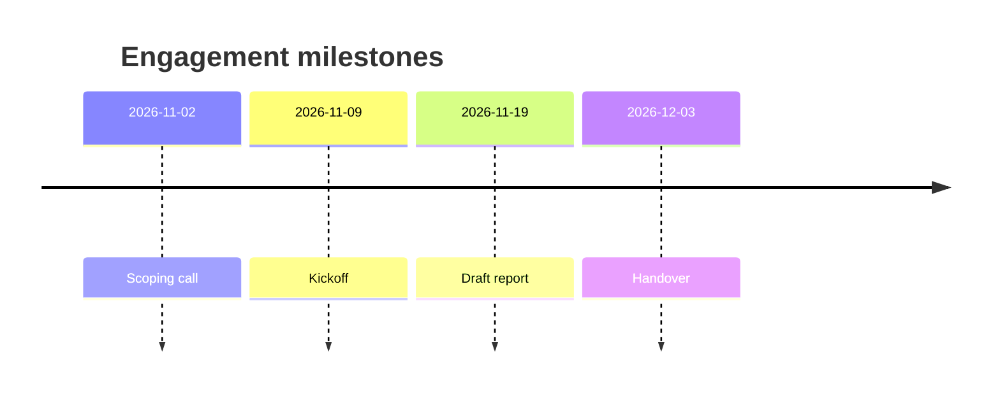
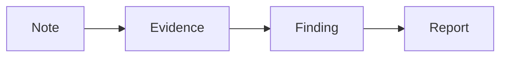

# Diagrams

Ten Mermaid diagrams about one engagement. Method notes: [[Engagement lifecycle]], [[Scoping call checklist]], [[Time tracking]].

## Flowchart

## Sequence

## State

## Class

## Entity relationship

## Gantt

## Pie

## Mindmap

## Timeline

## Second flowchart

