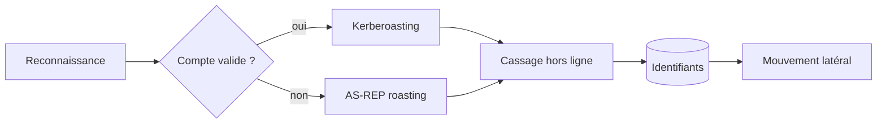
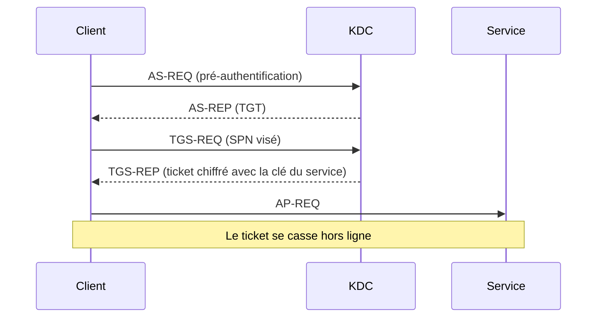
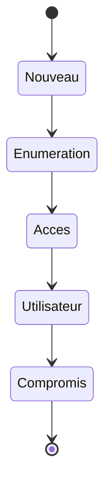
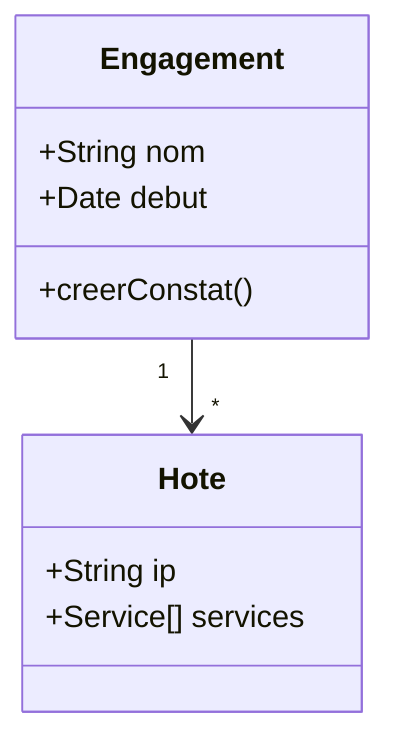
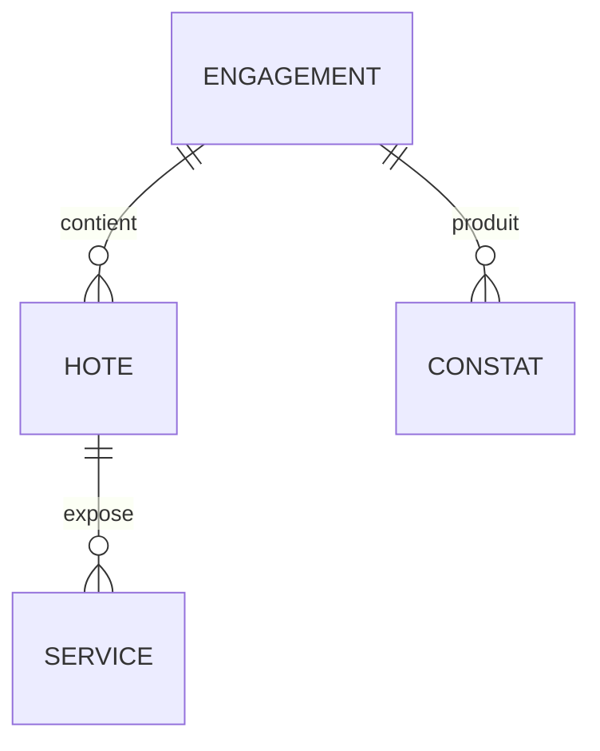
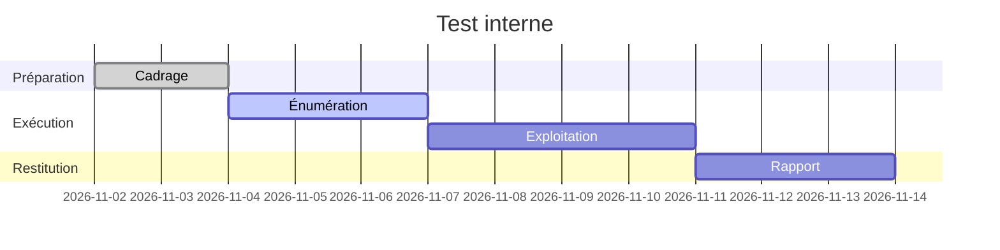
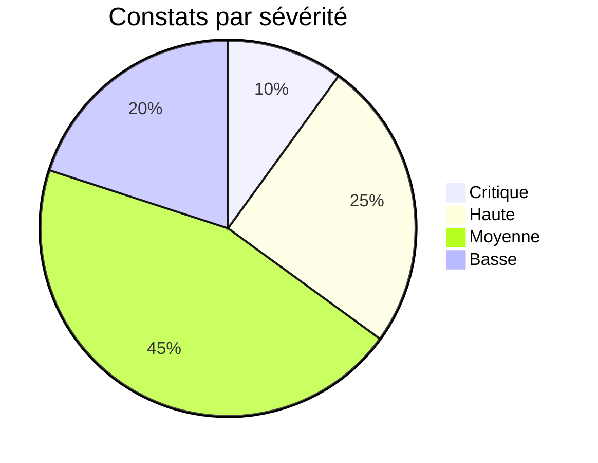
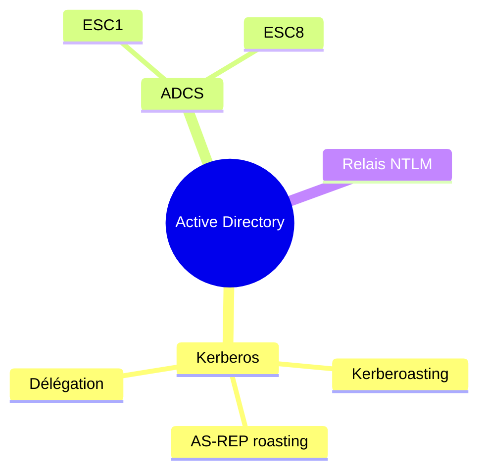
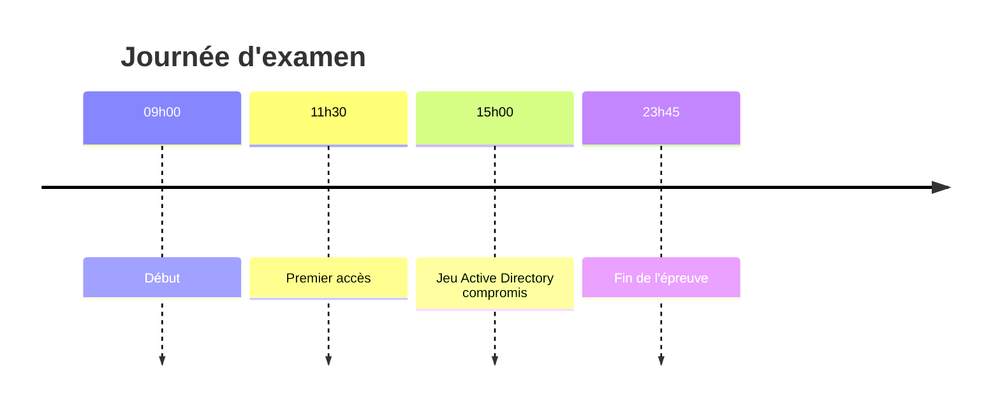

# Diagrammes

## Flowchart



## Séquence



## États



## Classes



## Entité-relation



## Gantt



## Camembert



## Carte mentale



## Chronologie



## Erreur de syntaxe

```mermaid
flowchart LR
    A --> 
    --> B[
```
