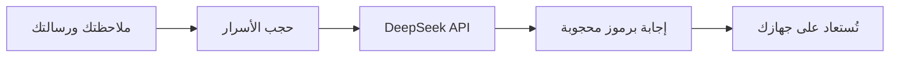

# الذكاء الاصطناعي والخصوصية

يتصل المساعد بواجهة DeepSeek API. تبيّن هذه الصفحة ما يغادر جهازك وكيف تُحجب الأسرار. للعودة إلى [[index|المساعدة]].

## ما يُرسل

لا يرسل Focus شيئًا من تلقاء نفسه. لا يُبنى الطلب إلا عندما تطلب شيئًا، ولا يحتوي إلا على:

- رسالتك؛
- السياق الذي تراه في الشرائح فوق حقل الإدخال: الملاحظة الحالية، والتحديد، والملاحظات التي أضفتها بالرمز `@`. ويظهر تقدير لعدد الرموز؛
- نتائج الأدوات التي استدعاها النموذج للبحث في الخزنة وقراءتها (البحث، قراءة ملاحظة، سرد مجلد، الروابط الراجعة، المخطط التفصيلي، الوسوم). يظهر كل استدعاء في المحادثة.

تعود إجابة النموذج وقيمها المحجوبة ما زالت مستبدلة برموز مثل `SECRET_1`، ويعيد Focus القيم الأصلية محليًا قبل عرضها.

## الحجب

قبل الإرسال، يستبدل Focus برمز كل ما يبدو سرًّا: كلمات المرور والتجزئات والمفاتيح والرموز التي تُعرف بأنماطها. يوسّع خياران ذلك ليشمل عناوين IP وأسماء المضيفين.

> [!warning] الحجب قائم على الأنماط
> النص الذي لا يطابق أي نمط معروف يُرسل كما هو. إذا كانت ملاحظة يجب ألا تغادر جهازك أبدًا، فلا تضفها إلى السياق، وأبقها خارج الخزنة التي تتيحها للأدوات.

## البحث بمساعدة الذكاء الاصطناعي

عند وجود مفتاح API وتفعيل مفتاح الذكاء الاصطناعي في لوحة البحث، يرسل الضغط على Enter:

- استعلامك، محجوبًا؛
- أسماء المجلدات وأكثر الوسوم استخدامًا في الخزنة (حتى 30 من كل منها) ولغة الواجهة، ليكتب النموذج استعلامات تناسب خزنتك؛
- للملاحظات التي عُثر عليها، حتى 40، عنوانها ومسارها وحتى ثلاثة مقتطفات من 600 حرف كحد أقصى، محجوبة.

يحدث ذلك عند Enter فقط، وليس أثناء الكتابة. تعرض اللوحة التكلفة التقديرية للتشغيل. إذا فشل الطلب، تبقى نتائجك المحلية ويشرح سطر واحد السبب. انظر [[search-syntax|صيغة البحث]] للوحة نفسها.

## الكتابة في الخزنة

المساعد يقرأ فقط افتراضيًا. عندما يقترح تغييرًا، يعرض Focus الفروقات وينتظر تأكيدك قبل الكتابة. الإجراءات على تحديد (التلخيص، إعادة الصياغة، التصحيح، الترجمة، المتابعة، الشرح، استخراج المهام، اقتراح عنوان ووسوم، توليد مخطط) تضع نتيجتها في المحادثة، أو تستبدل التحديد بعد معاينة، أو تدرجها في الأسفل، أو تنشئ ملاحظة، بحسب الإجراء. يمكن تحرير الموجّهات والإجراءات في الإعدادات، قسم الذكاء الاصطناعي.

## المفتاح والنموذج والتخزين

- يُقرأ مفتاح API من المتغير `DEEPSEEK_API_KEY` إن كان معيّنًا، وإلا من سلسلة مفاتيح النظام عبر `secret-tool`، وإلا من `~/.config/focus/deepseek.key` الذي ينشئه Focus بالصلاحيات 0600. لا يظهر المفتاح أبدًا في سجل أو في رسالة خطأ.
- النموذج الافتراضي هو `deepseek-flash`؛ ويمكن اختيار `deepseek-v4-pro`.
- تُحفظ المحادثات لكل خزنة في `~/.local/share/focus/`، على جهازك.
- الموجّهات بالإنجليزية. تتبع لغة الإجابة لغة الواجهة، أو لغة الملاحظة، أو لغة تحددها أنت، بحسب الإعداد.
