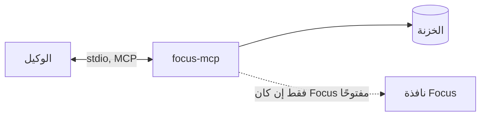

# ربط وكيل

`focus-mcp` برنامج صغير يشغّله وكيل ذكاء اصطناعي مثل Claude Code ويتخاطب معه عبر دخله وخرجه القياسيين، باستخدام Model Context Protocol. من خلاله يستطيع الوكيل البحث في خزنتك وقراءتها، وتتبع الروابط، وكتابة الملاحظات عندما تسمح له. للعودة إلى [[index|المساعدة]].



## ما يغادر جهازك

كل نتيجة أداة يستقبلها الوكيل (نص الملاحظات، مقتطفات البحث، أسطر السجل) تذهب إلى مزوّد ذلك الوكيل كجزء من المحادثة، وفق شروط ذلك المزوّد. لا يرسل Focus شيئًا من تلقاء نفسه. في وضع Ops تُحجب كلمات المرور والتجزئات في نتائج الأدوات ما لم تشغّل الخادم بالخيار `--reveal-secrets`. الملاحظة التي يجب ألا تغادر جهازك أبدًا لا مكان لها في الخزنة التي تتيحها.

## التثبيت والتعريف

ابنِ الخادم وضعه في مسارك:

```text
cargo build --release -p focus-mcp
install -m 755 target/release/focus-mcp ~/.local/bin/focus-mcp
```

عرّفه مرة واحدة في Claude Code، لكل مشاريعك:

```text
claude mcp add --transport stdio --scope user focus -- focus-mcp --vault "$HOME/notes"
claude mcp list
```

السطر `focus` الموسوم بأنه متصل يعني أن الخادم بدأ وأجاب. استبدل `$HOME/notes` بخزنتك.

## القراءة فقط، أو مع صلاحية الكتابة

| الوضع | الأمر | ما يستطيعه الوكيل |
|---|---|---|
| القراءة فقط (الافتراضي) | `focus-mcp --vault <path>` | البحث والقراءة والتحليل. أدوات الكتابة غير موجودة |
| الكتابة | `focus-mcp --vault <path> --write` | كما سبق، وأيضًا إنشاء الملاحظات وتغييرها وإعادة تسميتها ونقلها إلى سلة المحذوفات، وتأشير المهام، وتصدير الملفات، والكتابة في المهام |

> [!warning] لا تأكيد من Focus
> مع `--write`، تُنفَّذ الاستدعاءات دون تأكيد من Focus. التأكيد الوحيد هو ما يطلبه وكيلك قبل استخدام أداة. استخدم `--write` مع وكيل تسمح له بتحرير الخزنة، وأبقِ الخزنة تحت نظام إدارة الإصدارات أو لها نسخة احتياطية.

الاحتفاظ بتسجيلين، أحدهما للقراءة والآخر بالخيار `--write`، يتيح لك اختيار أيهما يكون نشطًا في كل جلسة.

## الأدوات

القراءة: `search_notes` و`read_note` و`list_folder` و`get_backlinks` و`get_outline` و`list_tags` و`get_neighbors` و`list_tasks` و`shortest_path` و`most_linked` و`orphan_notes` و`list_attachments` و`orphan_attachments`. الكتابة: `create_note` و`append_to_note` و`replace_in_note` و`toggle_task` و`rename_note` و`trash_note` و`export_note`. تظهر أدوات `ops_*` عندما تحتوي الخزنة على مجلد مهام، وتجيب أدوات `app_*` فقط عندما تكون نافذة Focus مفتوحة. تقبل `search_notes` صيغة [[search-syntax|صيغة البحث]].

`assets/skill/SKILL.md` مهارة لـ Claude Code تعلّم الوكيل أن يبحث قبل أن يقرأ، وأن يذكر مسار كل ملاحظة، وألا يكتب دون طلب.
