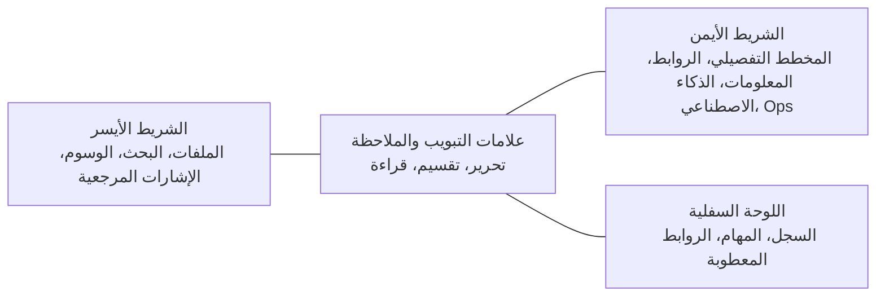

# البدء

تتناول هذه الصفحة فتح خزنة، وتخطيط النافذة، وطرق العرض الثلاث للملاحظة. للعودة إلى [[index|المساعدة]].

## فتح خزنة

الخزنة هي أي مجلد يحتوي على ملفات Markdown. عند التشغيل الأول يسألك Focus عن اللغة، ثم عن الخزنة المراد فتحها. تعيد عمليات التشغيل اللاحقة فتح آخر خزنة وعلامات التبويب التي كانت مفتوحة، ما لم توقف ذلك من الإعدادات، قسم عام. يمكنك فتح مجلد آخر في أي وقت من القسم نفسه، وتُعرض فيه أحدث الخزائن.

لا يكتب Focus في الخزنة إلا عندما تتصرف أنت: حفظ ملاحظة، أو إعادة تسمية، أو نقل، أو لصق صورة، أو تنفيذ استبدال. ولا ينشئ شيئًا في الخزنة عند فتحها. أما ذاكرته المؤقتة (فهرس البحث، البيانات الوصفية) فتوجد خارج الخزنة، في `~/.cache/focus/`.

## النافذة

- يضم الشريط الأيسر شجرة الملفات ولوحة البحث والوسوم مع عدّاداتها والإشارات المرجعية المقروءة من `.obsidian/bookmarks.json`. يُبدَّل إظهاره بـ Ctrl B.
- يعرض الشريط الأيمن المخطط التفصيلي للملاحظة وروابطها ومعلومات عنها، إضافة إلى تبويبي الذكاء الاصطناعي وOps. يُبدَّل إظهاره بـ Ctrl Alt B.
- تُفتح اللوحة السفلية بـ Ctrl J.
- يضم شريط العنوان زرّي الرجوع والتقدم، ومسار الملاحظة، وحقل البحث الذي يفتح لوحة الأوامر، ومفتاح التبديل بين طرق العرض الثلاث.
- يعرض شريط الحالة ما إذا كانت الملاحظة محفوظة، وموضع المؤشر، وعدد الكلمات.

يمكن تغيير حجم الأشرطة بسحب الفاصل بينها وبين الملاحظة. يُستعاد عرض كل شريط وعلامات التبويب المفتوحة والسمة عند التشغيل التالي.

## لوحة الأوامر

يفتح Ctrl K أو Ctrl P أو Ctrl O لوحة الأوامر. الكتابة تبحث عن الملاحظات بمطابقة تقريبية لعناوينها. يفتح Enter الملاحظة، ويفتحها Ctrl Enter في علامة تبويب جديدة. تغيّر البادئة ما يُبحث عنه:

| البادئة | تبحث في |
|---|---|
| بلا بادئة | الملاحظات |
| `>` | الأوامر |
| `#` | الوسوم |
| `@` | عناوين الملاحظة الحالية |
| `/` | النص الكامل للخزنة |

## ثلاث طرق لعرض الملاحظة

| العرض | ما تراه |
|---|---|
| تحرير | مصدر Markdown، مع تمييز الصياغة والتفاف الأسطر |
| تقسيم | المصدر على اليسار والملاحظة المعروضة على اليمين، ويتحركان معًا |
| قراءة | الملاحظة المعروضة: العناوين والتنبيهات والجداول والشيفرة مع تمييز الصياغة والصور ومخططات Mermaid والحواشي |

يبدّل Ctrl E بين التحرير والقراءة. في المصدر، تدرج قائمة الشرطة المائلة ([[slash-menu|قائمة الشرطة المائلة]]) الكتل، وتنسّق الاختصارات الواردة في [[keyboard-shortcuts|اختصارات لوحة المفاتيح]] النص.

يحفظ Focus بعد 800 ms من آخر ضغطة مفتاح، بكتابة ملف مؤقت ثم إعادة تسميته. إذا تغيرت الملاحظة على القرص أثناء تحريرك لها، يعرض شريط تنبيه إعادة تحميلها أو الاحتفاظ بنسختك.

> [!note] الإعدادات
> يفتح الاختصار `Ctrl ,` الإعدادات. يصفّيها حقل بحث في الأعلى حسب التسمية والوصف. يُطبَّق كل إعداد فورًا، وله زر إعادة تعيين.
