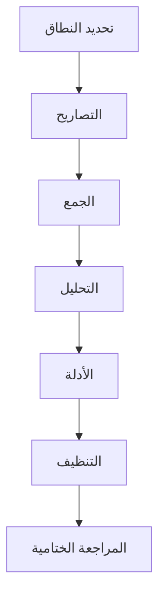

# وضع Ops

وضع Ops مخصص لحفظ سجلات اختبار اختراق أو مختبر: المهام والمضيفون والاكتشافات والسجل. هو معطّل افتراضيًا ولا يضيف شيئًا إلى الواجهة حتى تفعّله من الإعدادات، قسم Ops. للعودة إلى [[index|المساعدة]].

يُخزَّن كل شيء في ملاحظات Markdown عادية مع frontmatter داخل خزنتك، فيستطيع Obsidian قراءته ولا يضيف Focus قاعدة بيانات.

> [!warning] احمِ الخزنة
> تُخزَّن بيانات الاعتماد في جدول Markdown ضمن المهمة. أبقِ الخزنة على قرص مشفّر، وانظر [[connect-an-agent|ربط وكيل]] قبل إتاحتها لأداة.

## مهمة على القرص

```text
<vault>/<ops folder>/<name>/
  README.md                  type, status, dates, scope, variables
  Journal.md                 one line per entry
  Hosts/<host>.md            address, name, system, status, services
  Findings/<id>-<title>.md   severity, CVSS, status, affected assets
  Loot/Credentials.md        table of credentials
  Checklist.md               checkboxes by phase
  Evidence/                  pasted screenshots
  Report.md                  built from the rest
```

يبدو سطر السجل هكذا `- 2026-11-12 14:03:27 [10.10.10.5] text`: ختم زمني، والمضيف المستهدف بين قوسين معقوفين، ثم نصك. تحمل الإدخالات معرّف كتلة، فيمكن لملاحظة أن تستشهد بإدخال واحد بـ `[[Journal#^j-20261112-140327]]`.

## ما يقدمه وضع Ops

| الجزء | وظيفته |
|---|---|
| المهام | إنشاء مهمة من قالب (خارجي، داخلي، ويب، الفريق الأحمر، مختبر، اختبار)، واختيار المهمة النشطة، وتعيين الحالة والنطاق |
| السياق والهدف | متغيرات مثل `RHOST` و`LHOST` و`DOMAIN` و`USER`، والمضيف المستهدف. تعرض كتل الشيفرة في أي ملاحظة المتغيرات محلولة، مع نسخ بعد الحل ونسخ خام |
| السجل | إدخال سريع من لوحة المفاتيح، يمكن تصفيته في اللوحة السفلية، ويُصدَّر بصيغة CSV |
| المضيفون | جدول، واستيراد مخرجات nmap (XML وgrepable وnormal)، وملاحظة لكل مضيف، وزر لاستهدافه |
| الاكتشافات | قائمة مرتبة حسب الخطورة، مع حاسبة CVSS 3.1 و4.0، والحالة، والأصول المتأثرة، وتقنيات ATT&CK |
| بيانات الاعتماد | جدول بأسرار محجوبة مع إمكانية النسخ |
| قوائم التحقق | التقدم لكل مرحلة مع إبراز الخطوة التالية. يمكن لأي ملاحظة تحتوي على خانات اختيار أن تعمل قالبًا |
| مكتبة الأوامر | تُبنى من كتل شيفرة shell في ملاحظاتك أنت: لا يوفّر Focus أي أمر. بحث تقريبي، ومتغيرات محلولة، ونسخ، وإدراج في السجل |
| التقرير | تجميع Markdown للمهمة، مع معاينة |
| الاختبار | ملف تعريف مثل OSCP، ومؤقت في شريط العنوان، والنقاط المحصَّلة، وتذكير بالقواعد |

تحسب حاسبة CVSS الدرجة الأساسية فقط: تُقبل المقاييس الزمنية والبيئية والتكميلية في المتجه لكنها تُهمل.

## مراحل قائمة التحقق المرفقة

تصف قوالب قوائم التحقق مسار المهمة دون أي محتوى تقني:



## الروابط بين الكائنات

المهمة والمضيف والاكتشاف ملاحظات، فتَرتبط وتُرتبط بها كأي ملاحظة. تفتح الأصول المتأثرة في اكتشاف ملاحظات المضيفين، ويرتبط عنوان أو اسم مضيف في المهمة كُتب في إدخال سجل بملاحظة مضيفه. انظر [[links-and-embeds|الروابط والتضمين]].

> [!note] الأسرار والمساعد
> عند تفعيل وضع Ops، تُحجب الأسرار قبل إرسال أي شيء إلى المساعد، مع تذكير بما سيُرسل. انظر [[ai-and-privacy|الذكاء الاصطناعي والخصوصية]].
