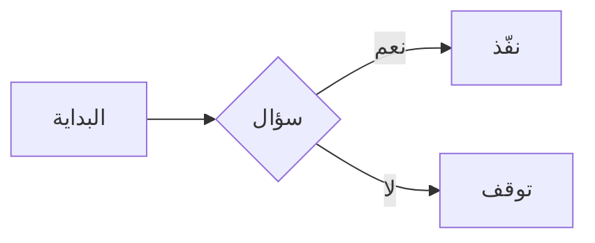

# قائمة الشرطة المائلة

كتابة `/` في بداية سطر أو بعد مسافة، في محرر المصدر، تفتح قائمة تحت المؤشر. للعودة إلى [[index|المساعدة]].

## الاستخدام

- واصل الكتابة للتصفية. المطابقة تقريبية، على التسمية وعلى كلمات مفتاحية بالفرنسية والإنجليزية: `/tab` و`/table` و`/tableau` تجد كلها الجدول.
- يتنقل Up وDown، ويدرج Enter أو Tab، ويغلق Escape. يلغي Backspace على `/` القائمة.
- تأتي العناصر التي استخدمتها مؤخرًا أولًا. تُخفى المجموعات بمجرد كتابة مرشِّح.
- يعرض كل صف أيقونة وتسمية ووصفًا قصيرًا واختصاره إن وُجد. الأوامر نفسها موجودة في لوحة الأوامر بعد `>`.

## المجموعات

| المجموعة | العناصر |
|---|---|
| التنسيق | العناوين من 1 إلى 6، عريض، مائل، يتوسطه خط، تمييز، شيفرة ضمن السطر، اقتباس، فاصل |
| القوائم | قائمة نقطية، قائمة مرقّمة، قائمة مهام |
| الكتل | كتلة شيفرة، جدول، تنبيهات، كتلة قابلة للطي، معادلة، حاشية، تعليق |
| الروابط والوسائط | رابط إلى ملاحظة، رابط خارجي، صورة، تضمين ملاحظة، وسم، مرفق |
| مخططات Mermaid | مخطط انسيابي، مخطط تسلسل، حالات، فئات، علاقات الكيانات، Gantt، مخطط دائري، خريطة ذهنية، خط زمني |
| عمليات الإدراج | تاريخ، وقت، تاريخ ووقت، قالب الخزنة، خاصية، جدول المحتويات |
| الذكاء الاصطناعي | إجراءات المساعد، الترجمة، واسأل الذكاء الاصطناعي |
| Ops | إدخال في السجل، اكتشاف جديد، بيانات اعتماد، مضيف، متغير سياق، أمر الخزنة، متجه CVSS، دليل من الحافظة (في وضع Ops فقط) |

للتنبيهات اثنا عشر نوعًا (note, info, tip, warning, danger, example, quote, question, success, failure, bug, abstract)، وكل نوع يأتي مربعًا عاديًا، أو مربعًا قابلًا للطي يبدأ مفتوحًا، أو مربعًا يبدأ مغلقًا. العنصر الذي لا تتوافر ميزته يظهر لكن لا يمكن إدراجه.

## ما يدرجه عنصر المخطط

يدرج كل عنصر Mermaid هيكلًا صالحًا تحرّره أنت. يعطي عنصر المخطط الانسيابي مخططًا صغيرًا:



> [!tip] Mermaid في ملاحظة
> الكتلة المسوّرة التي تبدأ بـ ` ```mermaid ` تُرسم في عرضي القراءة والتقسيم، بألوان الواجهة نفسها. يعرض خطأ الصياغة رسالة المُصيِّر مع المصدر. انظر [[links-and-embeds|الروابط والتضمين]] لجعل عقدة تفتح ملاحظة.
