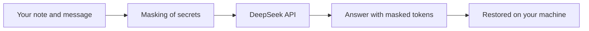

# AI and privacy

The assistant talks to the DeepSeek API. This page says what leaves your machine and how secrets are masked. Back to [[index|Help]].

## What is sent

Focus sends nothing by itself. A request is built only when you ask for something, and it holds only:

- your message;
- the context you can see in the chips above the input: the current note, the selection, and the notes you added with `@`. A token estimate is shown;
- the results of the tools the model called to search and read the vault (search, read a note, list a folder, backlinks, outline, tags). Each call is shown in the conversation.

The model's answer comes back with the masked values still replaced by tokens such as `SECRET_1`, and Focus puts the original values back locally before showing it.

## Masking

Before sending, Focus replaces what looks like a secret with a token: passwords, hashes, keys and tokens recognised by their patterns. Two options extend this to IP addresses and to host names.

> [!warning] Masking is pattern based
> Text that matches no known pattern is sent as written. If a note must never leave your machine, do not add it to the context and keep it out of the vault you expose to tools.

## Assisted search

With an API key and the AI switch on in the search panel, pressing Enter sends:

- your query, masked;
- the names of the folders and the most used tags of the vault (up to 30 of each) and the interface language, so that the model writes queries that fit your vault;
- for the notes found, up to 40, their title and path and up to three excerpts of at most 600 characters, masked.

It happens only on Enter, never while you type. The panel shows the estimated cost of the run. If the request fails, your local results stay and one line explains why. See [[search-syntax|Search syntax]] for the panel itself.

## Writing to the vault

The assistant only reads by default. When it proposes a change, Focus shows the difference and waits for your confirmation before writing. Actions on a selection (summarize, rephrase, correct, translate, continue, explain, extract tasks, suggest a title and tags, generate a diagram) put their result in the conversation, replace the selection after a preview, insert it below, or create a note, depending on the action. Prompts and actions are editable in Settings, section AI.

## Key, model and storage

- The API key is read from the `DEEPSEEK_API_KEY` variable if it is set, else from the system keyring through `secret-tool`, else from `~/.config/focus/deepseek.key`, which Focus creates with mode 0600. The key never appears in a log or in an error.
- The default model is `deepseek-flash`; `deepseek-v4-pro` can be chosen.
- Conversations are saved per vault in `~/.local/share/focus/`, on your machine.
- Prompts are in English. The answer language follows the interface language, the note's language or a language you fix, depending on the setting.
