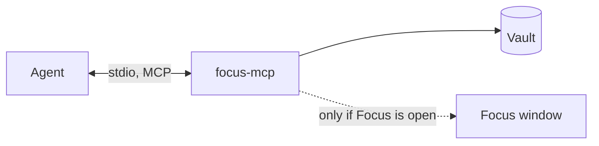

# Connect an agent

`focus-mcp` is a small program that an AI agent such as Claude Code starts and talks to over its standard input and output, using the Model Context Protocol. Through it the agent can search and read your vault, follow links, and write notes when you allow it. Back to [[index|Help]].



## What leaves your machine

Every tool result the agent receives (note text, search excerpts, journal lines) goes to the provider of that agent as part of the conversation, under that provider's terms. Focus sends nothing by itself. In Ops mode, passwords and hashes are masked in tool results unless you start the server with `--reveal-secrets`. A note that must never leave your machine has no place in the vault you expose.

## Install and declare

Build the server and put it on your path:

```text
cargo build --release -p focus-mcp
install -m 755 target/release/focus-mcp ~/.local/bin/focus-mcp
```

Declare it once in Claude Code, for all your projects:

```text
claude mcp add --transport stdio --scope user focus -- focus-mcp --vault "$HOME/notes"
claude mcp list
```

A line `focus` marked connected means the server started and answered. Replace `$HOME/notes` with your vault.

## Read only, or with write access

| Mode | Command | The agent can |
|---|---|---|
| Read only (default) | `focus-mcp --vault <path>` | search, read, analyze. The write tools do not exist |
| Write | `focus-mcp --vault <path> --write` | also create, change, rename and trash notes, check tasks, export files, write to engagements |

> [!warning] No confirmation from Focus
> With `--write`, calls run without a confirmation from Focus. The only confirmation is the one your agent asks before using a tool. Use `--write` with an agent you would let edit the vault, and keep the vault under version control or backed up.

Keeping two registrations, one for reading and one with `--write`, lets you choose per session which one is active.

## The tools

Reading: `search_notes`, `read_note`, `list_folder`, `get_backlinks`, `get_outline`, `list_tags`, `get_neighbors`, `list_tasks`, `shortest_path`, `most_linked`, `orphan_notes`, `list_attachments`, `orphan_attachments`. Writing: `create_note`, `append_to_note`, `replace_in_note`, `toggle_task`, `rename_note`, `trash_note`, `export_note`. The `ops_*` tools appear when the vault has an engagements folder, and the `app_*` tools answer only when the Focus window is open. `search_notes` takes the syntax of [[search-syntax|Search syntax]].

`assets/skill/SKILL.md` is a Claude Code skill that teaches the agent to search before reading, to cite the path of each note and never to write unasked.
