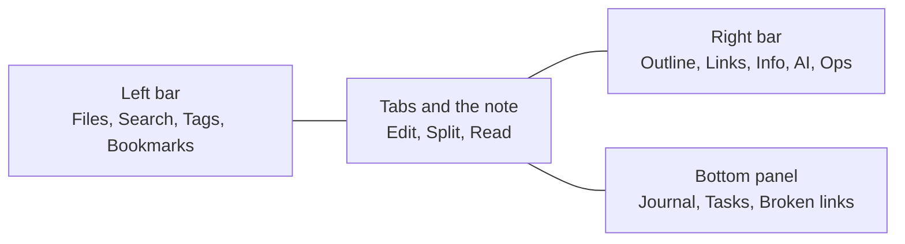

# Getting started

This page covers opening a vault, the layout of the window and the three views of a note. Back to [[index|Help]].

## Open a vault

A vault is any folder of Markdown files. On the first launch Focus asks for the language, then for the vault to open. Later launches reopen the last vault and the tabs that were open, unless you turn that off in Settings, section General. You can open another folder at any time from the same section, and the latest vaults are listed there.

Focus writes to the vault only when you act: saving a note, renaming, moving, pasting an image, running a replace. It creates nothing in the vault when it opens one. Its caches (search index, metadata) live outside the vault, in `~/.cache/focus/`.

## The window

- The left bar holds the file tree, the search panel, the tags with their counters and the bookmarks read from `.obsidian/bookmarks.json`. Toggle it with Ctrl B.
- The right bar shows the outline of the note, its links, information about it, and the AI and Ops tabs. Toggle it with Ctrl Alt B.
- The bottom panel opens with Ctrl J.
- The title bar has back and forward buttons, the breadcrumb of the note, the Search field that opens the palette, and the switch between the three views.
- The status bar shows whether the note is saved, the cursor position and the word count.

Bars can be resized by dragging the rule between them and the note. The width of each bar, the open tabs and the theme are restored at the next launch.

## The palette

Ctrl K, Ctrl P or Ctrl O opens the palette. Typing finds notes by fuzzy match on their titles. Enter opens the note, Ctrl Enter opens it in a new tab. A prefix changes what is searched:

| Prefix | Searches |
|---|---|
| none | notes |
| `>` | commands |
| `#` | tags |
| `@` | headings of the current note |
| `/` | the full text of the vault |

## Three views of a note

| View | What you see |
|---|---|
| Edit | the Markdown source, with highlighting and soft wrapping |
| Split | the source on the left, the rendered note on the right, scrolled together |
| Read | the rendered note: headings, callouts, tables, code with highlighting, images, Mermaid diagrams, footnotes |

Ctrl E switches between editing and reading. In the source, the slash menu ([[slash-menu|The slash menu]]) inserts blocks and the shortcuts in [[keyboard-shortcuts|Keyboard shortcuts]] format text.

Focus saves 800 ms after your last keystroke, by writing a temporary file and renaming it. If the note changes on disk while you are editing it, a banner offers to reload it or to keep your version.

> [!note] Settings
> Ctrl , opens the settings. A search field at the top filters them by label and description. Each setting applies at once and has a Reset button.
