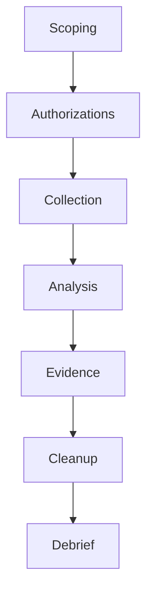

# Ops mode

Ops mode is for keeping the records of a penetration test or a lab: engagements, hosts, findings, a journal. It is off by default and adds nothing to the interface until you enable it in Settings, section Ops. Back to [[index|Help]].

Everything is stored as ordinary Markdown notes with frontmatter inside your vault, so Obsidian can read it and Focus adds no database.

> [!warning] Protect the vault
> Credentials are stored in a Markdown table of the engagement. Keep the vault on an encrypted disk, and see [[connect-an-agent|Connect an agent]] before exposing it to a tool.

## An engagement on disk

```text
<vault>/<ops folder>/<name>/
  README.md                  type, status, dates, scope, variables
  Journal.md                 one line per entry
  Hosts/<host>.md            address, name, system, status, services
  Findings/<id>-<title>.md   severity, CVSS, status, affected assets
  Loot/Credentials.md        table of credentials
  Checklist.md               checkboxes by phase
  Evidence/                  pasted screenshots
  Report.md                  built from the rest
```

A journal line looks like `- 2026-11-12 14:03:27 [10.10.10.5] text`: a timestamp, the target host in brackets, your text. Entries carry a block identifier, so a note can cite one entry with `[[Journal#^j-20261112-140327]]`.

## What Ops mode gives

| Part | What it does |
|---|---|
| Engagements | create one from a template (external, internal, web, red team, lab, exam), pick the active one, set status and scope |
| Context and target | variables such as `RHOST`, `LHOST`, `DOMAIN`, `USER`, and the targeted host. Code blocks in any note show the variables resolved, with Copy resolved and Copy raw |
| Journal | a quick entry from the keyboard, filterable in the bottom panel, exported as CSV |
| Hosts | a table, an import of nmap output (XML, grepable, normal), one note per host, a button to target it |
| Findings | a list sorted by severity, with a CVSS 3.1 and 4.0 calculator, status, affected assets and ATT&CK techniques |
| Credentials | a table with masked secrets and copy |
| Checklists | progress per phase and the next step highlighted. Any note that contains checkboxes can serve as a template |
| Command library | built from the shell code blocks of your own notes: Focus ships no command. Fuzzy search, variables resolved, copy, insert into the journal |
| Report | a Markdown assembly of the engagement, with a preview |
| Exam | a profile such as OSCP, a timer in the title bar, points earned and a reminder of the rules |

The CVSS calculator computes the base score only: temporal, environmental and supplemental metrics are accepted in a vector and ignored.

## Phases of the provided checklist

The checklist templates describe the course of an engagement without any technical content:



## Links between objects

An engagement, a host and a finding are notes, so they link and are linked like any note. A finding's affected assets open the host notes, and an address or host name of the engagement written in a journal entry links to its host. See [[links-and-embeds|Links and embeds]].

> [!note] Secrets and the assistant
> When Ops mode is on, secrets are masked before anything is sent to the assistant, with a reminder of what goes out. See [[ai-and-privacy|AI and privacy]].
