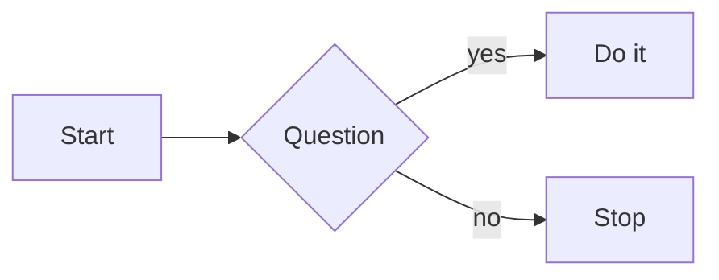

# The slash menu

Typing `/` at the start of a line or after a space, in the source editor, opens a menu under the cursor. Back to [[index|Help]].

## Using it

- Keep typing to filter. The match is fuzzy, on the label and on keywords in French and English: `/tab`, `/table` and `/tableau` all find the table.
- Up and Down move, Enter or Tab inserts, Escape closes. Backspace on the `/` cancels.
- Items you used recently come first. Groups are hidden once you type a filter.
- Every row shows an icon, a label, a short description and its shortcut when it has one. The same commands are in the palette after `>`.

## Groups

| Group | Entries |
|---|---|
| Formatting | headings 1 to 6, bold, italic, strikethrough, highlight, inline code, quote, rule |
| Lists | bulleted list, numbered list, task list |
| Blocks | code block, table, callouts, foldable block, math, footnote, comment |
| Links and media | link to a note, external link, image, note embed, tag, attachment |
| Mermaid diagrams | flowchart, sequence, states, classes, entity relationship, Gantt, pie chart, mind map, timeline |
| Insertions | date, time, date and time, vault template, property, table of contents |
| AI | the actions of the assistant, translate, and Ask the AI |
| Ops | journal entry, new finding, credential, host, context variable, vault command, CVSS vector, evidence from the clipboard (Ops mode only) |

Callouts come in twelve types (note, info, tip, warning, danger, example, quote, question, success, failure, bug, abstract), each as a plain box, a foldable box that starts open, or one that starts closed. An entry whose feature is not available is shown but cannot be inserted.

## What a diagram entry inserts

Each Mermaid entry inserts a valid skeleton that you edit. The flowchart entry gives a small diagram:



> [!tip] Mermaid in a note
> A fenced block that starts with ` ```mermaid ` is drawn in reading and split views, in the same colors as the interface. A syntax error shows the message of the renderer together with the source. See [[links-and-embeds|Links and embeds]] to make a node open a note.
