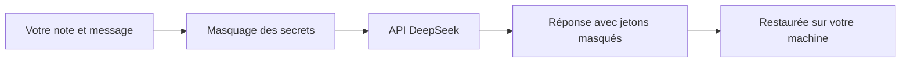

# IA et confidentialité

L'assistant parle à l'API DeepSeek. Cette page dit ce qui quitte votre machine et comment les secrets sont masqués. Retour à [[index|l'aide]].

## Ce qui est envoyé

Focus n'envoie rien de lui-même. Une requête n'est construite que lorsque vous demandez quelque chose, et elle ne contient que :

- votre message ;
- le contexte que vous voyez dans les pastilles au-dessus de la saisie : la note courante, la sélection, et les notes ajoutées avec `@`. Une estimation en jetons est affichée ;
- les résultats des outils que le modèle a appelés pour chercher et lire dans le coffre (recherche, lecture d'une note, liste d'un dossier, rétroliens, plan, tags). Chaque appel est montré dans la conversation.

La réponse du modèle revient avec les valeurs masquées toujours remplacées par des jetons comme `SECRET_1`, et Focus remet localement les valeurs d'origine avant de l'afficher.

## Masquage

Avant l'envoi, Focus remplace par un jeton ce qui ressemble à un secret : mots de passe, empreintes, clés et jetons reconnus par leur forme. Deux options l'étendent aux adresses IP et aux noms d'hôtes.

> [!warning] Le masquage repose sur des motifs
> Un texte qui ne correspond à aucun motif connu est envoyé tel quel. Si une note ne doit jamais quitter votre machine, ne l'ajoutez pas au contexte et gardez-la hors du coffre que vous exposez aux outils.

## Recherche assistée

Avec une clé d'API et l'interrupteur IA actif dans le panneau de recherche, Entrée envoie :

- votre requête, masquée ;
- les noms des dossiers et les tags les plus utilisés du coffre (30 de chaque au plus) et la langue de l'interface, pour que le modèle écrive des requêtes adaptées à votre coffre ;
- pour les notes trouvées, 40 au plus, leur titre et leur chemin et jusqu'à trois extraits de 600 caractères au plus, masqués.

Cela n'arrive que sur Entrée, jamais pendant la frappe. Le panneau montre le coût estimé de l'exécution. Si la requête échoue, vos résultats locaux restent et une ligne explique pourquoi. Voir [[search-syntax|Syntaxe de recherche]] pour le panneau lui-même.

## Écrire dans le coffre

L'assistant ne fait que lire par défaut. Quand il propose une modification, Focus montre la différence et attend votre confirmation avant d'écrire. Les actions sur une sélection (résumer, reformuler, corriger, traduire, continuer, expliquer, extraire les tâches, suggérer un titre et des tags, générer un diagramme) mettent leur résultat dans la conversation, remplacent la sélection après un aperçu, l'insèrent dessous ou créent une note, selon l'action. Les prompts et les actions se modifient dans les réglages, section IA.

## Clé, modèle et stockage

- La clé d'API est lue dans la variable `DEEPSEEK_API_KEY` si elle existe, sinon dans le trousseau du système par `secret-tool`, sinon dans `~/.config/focus/deepseek.key`, que Focus crée en mode 0600. La clé n'apparaît jamais dans un journal ni dans une erreur.
- Le modèle par défaut est `deepseek-flash` ; `deepseek-v4-pro` peut être choisi.
- Les conversations sont enregistrées par coffre dans `~/.local/share/focus/`, sur votre machine.
- Les prompts sont en anglais. La langue de la réponse suit la langue de l'interface, celle de la note ou une langue que vous fixez, selon le réglage.
