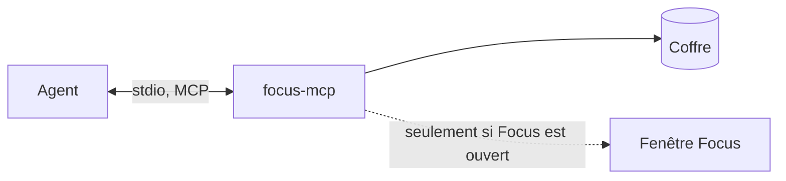

# Brancher un agent

`focus-mcp` est un petit programme qu'un agent IA comme Claude Code lance et avec lequel il parle sur son entrée et sa sortie standard, par le Model Context Protocol. Par lui l'agent peut chercher et lire dans votre coffre, suivre les liens, et écrire des notes quand vous l'autorisez. Retour à [[index|l'aide]].



## Ce qui quitte votre machine

Chaque résultat d'outil que reçoit l'agent (texte de note, extraits de recherche, lignes de journal) part chez le fournisseur de cet agent, dans la conversation, selon les conditions de ce fournisseur. Focus n'envoie rien de lui-même. En mode Ops, mots de passe et empreintes sont masqués dans les résultats d'outils sauf si vous lancez le serveur avec `--reveal-secrets`. Une note qui ne doit jamais quitter votre machine n'a pas sa place dans le coffre que vous exposez.

## Installer et déclarer

Construisez le serveur et placez-le dans votre chemin :

```text
cargo build --release -p focus-mcp
install -m 755 target/release/focus-mcp ~/.local/bin/focus-mcp
```

Déclarez-le une fois dans Claude Code, pour tous vos projets :

```text
claude mcp add --transport stdio --scope user focus -- focus-mcp --vault "$HOME/notes"
claude mcp list
```

Une ligne `focus` marquée connectée signifie que le serveur a démarré et répondu. Remplacez `$HOME/notes` par votre coffre.

## Lecture seule, ou avec écriture

| Mode | Commande | L'agent peut |
|---|---|---|
| Lecture seule (défaut) | `focus-mcp --vault <chemin>` | chercher, lire, analyser. Les outils d'écriture n'existent pas |
| Écriture | `focus-mcp --vault <chemin> --write` | aussi créer, modifier, renommer et mettre à la corbeille des notes, cocher des tâches, exporter des fichiers, écrire dans les missions |

> [!warning] Aucune confirmation de la part de Focus
> Avec `--write`, les appels s'exécutent sans confirmation de Focus. La seule confirmation est celle que votre agent demande avant d'employer un outil. N'employez `--write` qu'avec un agent que vous laisseriez modifier le coffre, et gardez le coffre sous gestion de versions ou sauvegardé.

Garder deux déclarations, une pour la lecture et une avec `--write`, permet de choisir à chaque session laquelle est active.

## Les outils

Lecture : `search_notes`, `read_note`, `list_folder`, `get_backlinks`, `get_outline`, `list_tags`, `get_neighbors`, `list_tasks`, `shortest_path`, `most_linked`, `orphan_notes`, `list_attachments`, `orphan_attachments`. Écriture : `create_note`, `append_to_note`, `replace_in_note`, `toggle_task`, `rename_note`, `trash_note`, `export_note`. Les outils `ops_*` apparaissent quand le coffre a un dossier de missions, et les outils `app_*` ne répondent que lorsque la fenêtre Focus est ouverte. `search_notes` prend la syntaxe de [[search-syntax|Syntaxe de recherche]].

`assets/skill/SKILL.md` est une compétence Claude Code qui apprend à l'agent à chercher avant de lire, à citer le chemin de chaque note et à ne jamais écrire sans demande.
