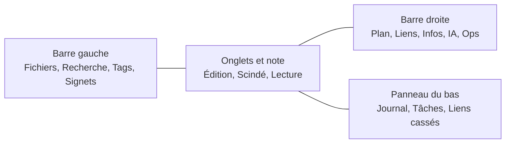

# Premiers pas

Cette page couvre l'ouverture d'un coffre, la disposition de la fenêtre et les trois vues d'une note. Retour à [[index|l'aide]].

## Ouvrir un coffre

Un coffre est un dossier de fichiers Markdown. Au premier lancement, Focus demande la langue, puis le coffre à ouvrir. Les lancements suivants rouvrent le dernier coffre et les onglets qui étaient ouverts, sauf si vous le désactivez dans les réglages, section Général. Vous pouvez ouvrir un autre dossier à tout moment depuis la même section, où les derniers coffres sont listés.

Focus n'écrit dans le coffre que sur une action de votre part : enregistrer une note, renommer, déplacer, coller une image, lancer un remplacement. Il ne crée rien dans le coffre à l'ouverture. Ses caches (index de recherche, métadonnées) vivent hors du coffre, dans `~/.cache/focus/`.

## La fenêtre

- La barre gauche contient l'arbre des fichiers, le panneau de recherche, les tags avec leurs compteurs et les signets lus dans `.obsidian/bookmarks.json`. Ctrl B l'affiche ou la masque.
- La barre droite montre le plan de la note, ses liens, des informations sur elle, et les onglets IA et Ops. Ctrl Alt B l'affiche ou la masque.
- Le panneau du bas s'ouvre avec Ctrl J.
- La barre de titre a les boutons précédent et suivant, le fil d'Ariane de la note, le champ Rechercher qui ouvre la palette, et le sélecteur des trois vues.
- La barre d'état indique si la note est enregistrée, la position du curseur et le nombre de mots.

Les barres se redimensionnent en glissant le filet entre elles et la note. La largeur de chaque barre, les onglets ouverts et le thème sont restaurés au lancement suivant.

## La palette

Ctrl K, Ctrl P ou Ctrl O ouvre la palette. La saisie cherche les notes par correspondance floue sur leur titre. Entrée ouvre la note, Ctrl Entrée l'ouvre dans un nouvel onglet. Un préfixe change ce qui est cherché :

| Préfixe | Cherche |
|---|---|
| aucun | les notes |
| `>` | les commandes |
| `#` | les tags |
| `@` | les titres de la note courante |
| `/` | le texte intégral du coffre |

## Trois vues d'une note

| Vue | Ce que vous voyez |
|---|---|
| Édition | la source Markdown, avec coloration et retour à la ligne |
| Scindé | la source à gauche, la note rendue à droite, défilant ensemble |
| Lecture | la note rendue : titres, callouts, tableaux, code coloré, images, diagrammes Mermaid, notes de bas de page |

Ctrl E alterne entre édition et lecture. Dans la source, le menu « / » ([[slash-menu|Le menu « / »]]) insère des blocs et les raccourcis de [[keyboard-shortcuts|Raccourcis clavier]] mettent le texte en forme.

Focus enregistre 800 ms après votre dernière frappe, en écrivant un fichier temporaire puis en le renommant. Si la note change sur le disque pendant que vous l'éditez, un bandeau propose de la recharger ou de garder votre version.

> [!note] Réglages
> Ctrl , ouvre les réglages. Un champ de recherche en haut les filtre par libellé et description. Chaque réglage s'applique tout de suite et a un bouton Réinitialiser.
