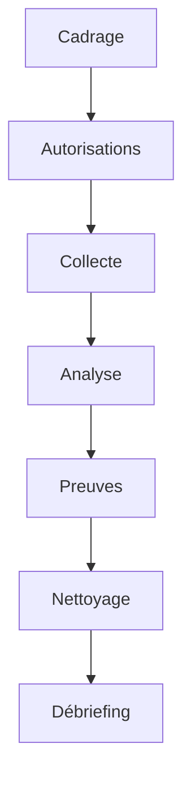

# Mode Ops

Le mode Ops sert à tenir les dossiers d'un test d'intrusion ou d'un laboratoire : missions, hôtes, constats, journal. Il est désactivé par défaut et n'ajoute rien à l'interface tant que vous ne l'activez pas dans les réglages, section Ops. Retour à [[index|l'aide]].

Tout est stocké en notes Markdown ordinaires avec frontmatter dans votre coffre : Obsidian peut les lire et Focus n'ajoute aucune base de données.

> [!warning] Protégez le coffre
> Les identifiants sont stockés dans un tableau Markdown de la mission. Gardez le coffre sur un disque chiffré, et lisez [[connect-an-agent|Brancher un agent]] avant de l'exposer à un outil.

## Une mission sur le disque

```text
<coffre>/<dossier ops>/<nom>/
  README.md                  type, statut, dates, périmètre, variables
  Journal.md                 une ligne par entrée
  Hosts/<hôte>.md            adresse, nom, système, statut, services
  Findings/<id>-<titre>.md   gravité, CVSS, statut, actifs concernés
  Loot/Credentials.md        tableau des identifiants
  Checklist.md               cases à cocher par phase
  Evidence/                  captures collées
  Report.md                  construit à partir du reste
```

Une ligne de journal ressemble à `- 2026-11-12 14:03:27 [10.10.10.5] texte` : un horodatage, l'hôte visé entre crochets, votre texte. Les entrées portent un identifiant de bloc, donc une note peut citer une entrée avec `[[Journal#^j-20261112-140327]]`.

## Ce que donne le mode Ops

| Partie | Ce qu'elle fait |
|---|---|
| Missions | en créer une depuis un gabarit (externe, interne, web, red team, labo, examen), choisir la mission active, fixer statut et périmètre |
| Contexte et cible | variables comme `RHOST`, `LHOST`, `DOMAIN`, `USER`, et l'hôte visé. Les blocs de code de toute note montrent les variables résolues, avec Copier résolu et Copier brut |
| Journal | une saisie rapide au clavier, filtrable dans le panneau du bas, exportée en CSV |
| Hôtes | un tableau, un import de sortie nmap (XML, grepable, normale), une note par hôte, un bouton pour le viser |
| Constats | une liste triée par gravité, avec un calculateur CVSS 3.1 et 4.0, le statut, les actifs concernés et les techniques ATT&CK |
| Identifiants | un tableau avec secrets masqués et copie |
| Listes de contrôle | progression par phase et étape suivante en évidence. Toute note qui contient des cases à cocher peut servir de gabarit |
| Bibliothèque de commandes | construite à partir des blocs de code shell de vos propres notes : Focus ne fournit aucune commande. Recherche floue, variables résolues, copie, insertion dans le journal |
| Rapport | un assemblage Markdown de la mission, avec un aperçu |
| Examen | un profil comme OSCP, un minuteur dans la barre de titre, les points obtenus et un rappel des règles |

Le calculateur CVSS ne calcule que le score de base : les métriques temporelles, environnementales et supplémentaires sont acceptées dans un vecteur et ignorées.

## Phases de la liste de contrôle fournie

Les gabarits de liste décrivent le déroulement d'une mission sans aucun contenu technique :



## Liens entre objets

Une mission, un hôte et un constat sont des notes : ils lient et sont liés comme n'importe quelle note. Les actifs concernés d'un constat ouvrent les notes d'hôtes, et une adresse ou un nom d'hôte de la mission écrit dans une entrée de journal mène à son hôte. Voir [[links-and-embeds|Liens et inclusions]].

> [!note] Secrets et assistant
> Quand le mode Ops est actif, les secrets sont masqués avant tout envoi à l'assistant, avec un rappel de ce qui sort. Voir [[ai-and-privacy|IA et confidentialité]].
