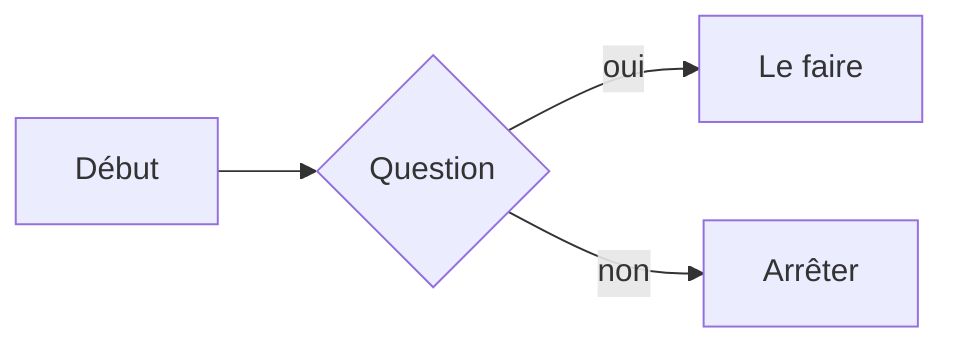

# Le menu « / »

Taper `/` en début de ligne ou après une espace, dans l'éditeur de source, ouvre un menu sous le curseur. Retour à [[index|l'aide]].

## L'utiliser

- Continuez à taper pour filtrer. La correspondance est floue, sur le libellé et sur des mots-clés en français et en anglais : `/tab`, `/table` et `/tableau` trouvent tous le tableau.
- Haut et Bas déplacent, Entrée ou Tab insère, Échap ferme. Retour arrière sur le `/` annule.
- Les éléments utilisés récemment viennent en premier. Les groupes sont masqués dès que vous tapez un filtre.
- Chaque ligne montre une icône, un libellé, une courte description et son raccourci s'il en a un. Les mêmes commandes sont dans la palette après `>`.

## Groupes

| Groupe | Entrées |
|---|---|
| Mise en forme | titres 1 à 6, gras, italique, barré, surlignage, code en ligne, citation, filet |
| Listes | liste à puces, liste numérotée, liste de tâches |
| Blocs | bloc de code, tableau, callouts, bloc repliable, formule, note de bas de page, commentaire |
| Liens et médias | lien vers une note, lien externe, image, inclusion de note, tag, pièce jointe |
| Diagrammes Mermaid | organigramme, séquence, états, classes, entité-relation, Gantt, camembert, carte mentale, chronologie |
| Insertions | date, heure, date et heure, gabarit du coffre, propriété, table des matières |
| IA | les actions de l'assistant, traduire, et Demander à l'IA |
| Ops | entrée de journal, nouveau constat, identifiant, hôte, variable de contexte, commande du coffre, vecteur CVSS, preuve du presse-papiers (mode Ops seulement) |

Les callouts existent en douze types (note, info, tip, warning, danger, example, quote, question, success, failure, bug, abstract), chacun en boîte simple, en boîte repliable ouverte au départ, ou fermée au départ. Une entrée dont la fonction n'est pas disponible est affichée mais ne peut pas être insérée.

## Ce qu'insère une entrée de diagramme

Chaque entrée Mermaid insère un squelette valide que vous modifiez. L'entrée d'organigramme donne un petit diagramme :



> [!tip] Mermaid dans une note
> Un bloc délimité qui commence par ` ```mermaid ` est dessiné en vues lecture et scindée, aux couleurs de l'interface. Une erreur de syntaxe affiche le message du moteur avec la source. Voir [[links-and-embeds|Liens et inclusions]] pour qu'un nœud ouvre une note.
