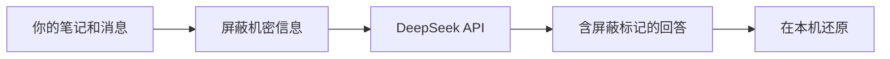

# AI 与隐私

助手通过 DeepSeek API 工作。本页说明哪些内容会离开你的电脑，以及如何屏蔽机密信息。返回 [[index|帮助]]。

## 发送的内容

Focus 不会自行发送任何内容。只有在你提出请求时才会构建请求，其中只包含：

- 你的消息；
- 你在输入框上方标签块中能看到的上下文：当前笔记、选中内容，以及你用 `@` 添加的笔记。界面会显示 token 估算值；
- 模型为搜索和读取库而调用的工具的结果（搜索、读取笔记、列出文件夹、反向链接、大纲、标签）。每次调用都会显示在对话中。

模型的回答返回时，被屏蔽的值仍然是 `SECRET_1` 这样的标记，Focus 会在本机把原始值放回去，然后再显示。

## 屏蔽

发送之前，Focus 会把看起来像机密的内容替换为标记：根据模式识别出的密码、哈希、密钥和令牌。有两个选项可以把范围扩大到 IP 地址和主机名。

> [!warning] 屏蔽基于模式
> 不符合任何已知模式的文本会按原样发送。如果某篇笔记绝不能离开你的电脑，请不要把它加入上下文，并让它不在你向工具开放的库中。

## 辅助搜索

有 API 密钥并在搜索面板中开启 AI 开关时，按 Enter 会发送：

- 你的查询（已屏蔽）；
- 库中的文件夹名称和最常用的标签（各最多 30 个）以及界面语言，让模型写出适合你的库的查询；
- 对于找到的笔记（最多 40 篇），发送它们的标题和路径，以及最多三段、每段不超过 600 个字符的摘录（已屏蔽）。

这只在按 Enter 时发生，输入过程中不会发生。面板会显示本次运行的预估费用。如果请求失败，本地结果会保留，并用一行文字说明原因。面板本身见[[search-syntax|搜索语法]]。

## 写入库

助手默认只读。当它提出修改时，Focus 会显示差异，并在写入前等待你的确认。针对选中内容的操作（总结、改写、纠错、翻译、续写、解释、提取任务、建议标题和标签、生成图表）会根据操作的不同，把结果放在对话中、预览后替换选中内容、插入到下方，或创建一篇笔记。提示词和操作可在“设置”的“AI”分区中编辑。

## 密钥、模型和存储

- API 密钥优先从 `DEEPSEEK_API_KEY` 变量读取（如果已设置），其次通过 `secret-tool` 从系统密钥环读取，最后从 `~/.config/focus/deepseek.key` 读取，该文件由 Focus 创建，权限为 0600。密钥不会出现在日志或错误信息中。
- 默认模型是 `deepseek-flash`，也可以选择 `deepseek-v4-pro`。
- 对话按库保存在 `~/.local/share/focus/` 中，位于你的电脑上。
- 提示词使用英语。回答语言取决于设置，可以跟随界面语言、笔记的语言，或你指定的语言。
