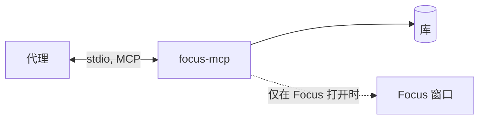

# 连接代理

`focus-mcp` 是一个小程序，由 Claude Code 等 AI 代理启动，并通过标准输入和输出，使用 Model Context Protocol 与其通信。借助它，代理可以搜索和读取你的库、跟随链接，并在你允许时写入笔记。返回 [[index|帮助]]。



## 哪些内容会离开你的电脑

代理收到的每个工具结果（笔记文本、搜索摘录、日志行）都会作为对话的一部分发送给该代理的服务商，并适用该服务商的条款。Focus 不会自行发送任何内容。在 Ops 模式下，工具结果中的密码和哈希会被屏蔽，除非你用 `--reveal-secrets` 启动服务器。绝不能离开你的电脑的笔记，不应放在你向外开放的库中。

## 安装与声明

构建服务器并放到你的路径中：

```text
cargo build --release -p focus-mcp
install -m 755 target/release/focus-mcp ~/.local/bin/focus-mcp
```

在 Claude Code 中声明一次，对你所有的项目生效：

```text
claude mcp add --transport stdio --scope user focus -- focus-mcp --vault "$HOME/notes"
claude mcp list
```

标记为已连接的 `focus` 行表示服务器已启动并作出了响应。请把 `$HOME/notes` 换成你的库。

## 只读，或带写入权限

| 模式 | 命令 | 代理可以 |
|---|---|---|
| 只读（默认） | `focus-mcp --vault <path>` | 搜索、读取、分析。写入工具不存在 |
| 写入 | `focus-mcp --vault <path> --write` | 还可以创建、修改、重命名笔记并移入回收站、勾选任务、导出文件、写入项目 |

> [!warning] Focus 不会请求确认
> 使用 `--write` 时，调用不经过 Focus 的确认。唯一的确认是你的代理在使用工具之前询问的那一次。只对你愿意让其编辑库的代理使用 `--write`，并对库做好版本控制或备份。

同时保留两个注册，一个只读，一个带 `--write`，就可以在每次会话中选择启用哪一个。

## 工具

读取：`search_notes`、`read_note`、`list_folder`、`get_backlinks`、`get_outline`、`list_tags`、`get_neighbors`、`list_tasks`、`shortest_path`、`most_linked`、`orphan_notes`、`list_attachments`、`orphan_attachments`。写入：`create_note`、`append_to_note`、`replace_in_note`、`toggle_task`、`rename_note`、`trash_note`、`export_note`。当库中有项目文件夹时会出现 `ops_*` 工具，而 `app_*` 工具只在 Focus 窗口打开时才会响应。`search_notes` 使用[[search-syntax|搜索语法]]中的语法。

`assets/skill/SKILL.md` 是一个 Claude Code 技能，教代理先搜索再读取、引用每篇笔记的路径，并且绝不未经要求就写入。
