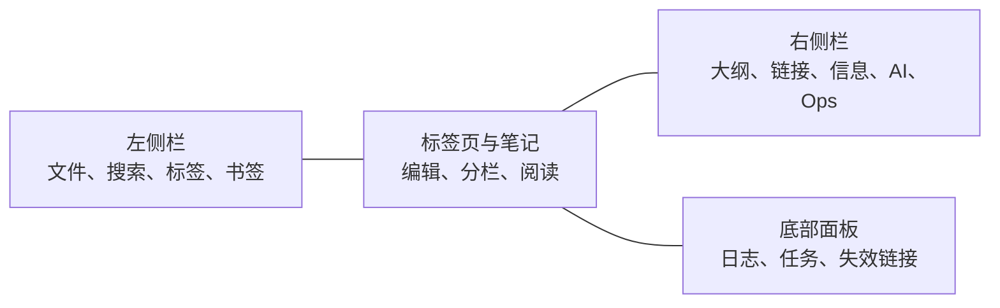

# 快速入门

本页介绍如何打开库、窗口布局以及笔记的三种视图。返回 [[index|帮助]]。

## 打开库

库就是任何一个包含 Markdown 文件的文件夹。首次启动时，Focus 会先询问语言，再询问要打开的库。之后每次启动都会重新打开上次的库和当时打开的标签页，除非你在“设置”的“通用”中关闭此行为。你可以随时在同一分区中打开其他文件夹，最近使用的库也列在那里。

只有在你操作时，Focus 才会写入库：保存笔记、重命名、移动、粘贴图片、执行替换。打开库时它不会在库中创建任何内容。它的缓存（搜索索引、元数据）放在库之外的 `~/.cache/focus/` 中。

## 窗口

- 左侧栏包含文件树、搜索面板、带计数的标签，以及从 `.obsidian/bookmarks.json` 读取的书签。用 Ctrl B 显示或隐藏。
- 右侧栏显示笔记的大纲、链接、笔记信息，以及 AI 和 Ops 标签页。用 Ctrl Alt B 显示或隐藏。
- 底部面板用 Ctrl J 打开。
- 标题栏有后退和前进按钮、笔记的面包屑、用于打开命令面板的搜索框，以及三种视图之间的切换。
- 状态栏显示笔记是否已保存、光标位置和字数。

拖动侧栏与笔记之间的分隔线可以调整侧栏大小。每个侧栏的宽度、打开的标签页和主题会在下次启动时恢复。

## 命令面板

Ctrl K、Ctrl P 或 Ctrl O 打开命令面板。输入内容会按标题对笔记做模糊匹配。Enter 打开笔记，Ctrl Enter 在新标签页中打开。前缀决定搜索的对象：

| 前缀 | 搜索 |
|---|---|
| 无 | 笔记 |
| `>` | 命令 |
| `#` | 标签 |
| `@` | 当前笔记的标题 |
| `/` | 库的全文 |

## 笔记的三种视图

| 视图 | 你看到的内容 |
|---|---|
| 编辑 | Markdown 源码，带语法高亮和自动换行 |
| 分栏 | 左侧是源码，右侧是渲染后的笔记，两侧同步滚动 |
| 阅读 | 渲染后的笔记：标题、提示框、表格、带高亮的代码、图片、Mermaid 图表、脚注 |

Ctrl E 在编辑和阅读之间切换。在源码中，斜杠菜单（[[slash-menu|斜杠菜单]]）用于插入块，[[keyboard-shortcuts|键盘快捷键]]中的快捷键用于设置文本格式。

Focus 会在你最后一次按键 800 毫秒后保存，方式是先写入临时文件再重命名。如果笔记在你编辑期间在磁盘上发生了变化，会出现横幅，让你选择重新载入或保留你的版本。

> [!note] 设置
> Ctrl , 打开设置。顶部的搜索框按名称和说明筛选设置项。每项设置立即生效，并带有“重置”按钮。
