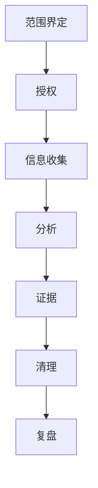

# Ops 模式

Ops 模式用于记录一次渗透测试或实验环境：项目、主机、发现项、日志。它默认关闭，在你于“设置”的“Ops”分区中启用之前不会给界面增加任何内容。返回 [[index|帮助]]。

所有内容都以带 frontmatter 的普通 Markdown 笔记形式存放在你的库中，所以 Obsidian 可以读取，Focus 也不添加数据库。

> [!warning] 保护好库
> 凭据存放在项目的 Markdown 表格中。请把库放在加密磁盘上，并在向工具开放之前阅读[[connect-an-agent|连接代理]]。

## 磁盘上的项目

```text
<vault>/<ops folder>/<name>/
  README.md                  type, status, dates, scope, variables
  Journal.md                 one line per entry
  Hosts/<host>.md            address, name, system, status, services
  Findings/<id>-<title>.md   severity, CVSS, status, affected assets
  Loot/Credentials.md        table of credentials
  Checklist.md               checkboxes by phase
  Evidence/                  pasted screenshots
  Report.md                  built from the rest
```

日志中的一行形如 `- 2026-11-12 14:03:27 [10.10.10.5] text`：时间戳、方括号中的目标主机，以及你的文字。条目带有块标识符，所以一篇笔记可以用 `[[Journal#^j-20261112-140327]]` 引用某一条。

## Ops 模式提供的功能

| 部分 | 作用 |
|---|---|
| 项目 | 从模板创建（外部、内部、Web、红队、实验环境、考试），选择当前项目，设置状态和范围 |
| 上下文与目标 | `RHOST`、`LHOST`、`DOMAIN`、`USER` 等变量，以及当前的目标主机。任何笔记中的代码块都会显示解析后的变量，并提供“复制解析后的内容”和“复制原文” |
| 日志 | 用键盘快速添加条目，可在底部面板中筛选，可导出为 CSV |
| 主机 | 一个表格，可导入 nmap 输出（XML、grepable、normal），每台主机一篇笔记，并有设为目标的按钮 |
| 发现项 | 按严重程度排序的列表，带 CVSS 3.1 和 4.0 计算器、状态、受影响资产和 ATT&CK 技术 |
| 凭据 | 机密信息被遮盖的表格，可复制 |
| 检查清单 | 按阶段显示进度，并突出显示下一步。任何含有复选框的笔记都可以用作模板 |
| 命令库 | 由你自己笔记中的 shell 代码块构建：Focus 不自带任何命令。支持模糊搜索、变量解析、复制、插入日志 |
| 报告 | 用 Markdown 汇总项目内容，带预览 |
| 考试 | OSCP 等考试配置、标题栏中的计时器、已得分数和规则提醒 |

CVSS 计算器只计算基础分：时间、环境和补充指标可以写在向量中，但会被忽略。

## 所提供检查清单的阶段

检查清单模板描述了项目的进行过程，不含任何技术内容：



## 对象之间的链接

项目、主机和发现项都是笔记，所以它们可以像任何笔记一样链接和被链接。发现项的受影响资产会打开对应的主机笔记，项目中的地址或主机名写在日志条目里时，会链接到对应的主机。见[[links-and-embeds|链接与嵌入]]。

> [!note] 机密信息与助手
> 开启 Ops 模式后，在向助手发送任何内容之前都会先屏蔽机密信息，并提示将要发送的内容。见 [[ai-and-privacy|AI 与隐私]]。
