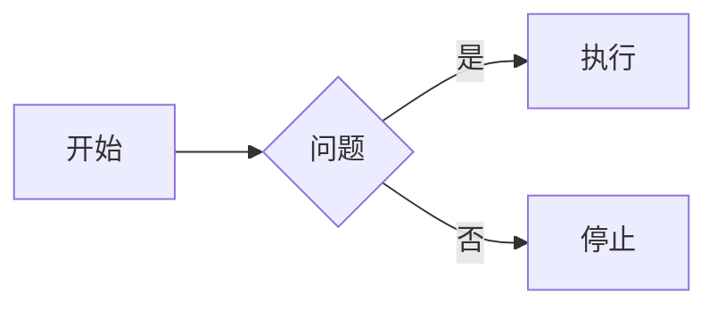

# 斜杠菜单

在源码编辑器中，于行首或空格之后输入 `/`，光标下方会打开一个菜单。返回 [[index|帮助]]。

## 使用方法

- 继续输入即可筛选。匹配是模糊的，对象包括名称以及法语和英语的关键词：`/tab`、`/table` 和 `/tableau` 都能找到表格。
- Up 和 Down 移动，Enter 或 Tab 插入，Escape 关闭。在 `/` 上按 Backspace 可取消。
- 最近用过的条目排在最前面。输入筛选内容后，分组标题会隐藏。
- 每一行显示图标、名称、简短说明，以及快捷键（如果有）。同样的命令在命令面板中输入 `>` 后也能找到。

## 分组

| 分组 | 条目 |
|---|---|
| 格式 | 1 到 6 级标题、粗体、斜体、删除线、高亮、行内代码、引用、分隔线 |
| 列表 | 无序列表、有序列表、任务列表 |
| 块 | 代码块、表格、提示框、可折叠块、数学公式、脚注、注释 |
| 链接与媒体 | 笔记链接、外部链接、图片、笔记嵌入、标签、附件 |
| Mermaid 图表 | 流程图、时序图、状态图、类图、实体关系图、甘特图、饼图、思维导图、时间线 |
| 插入 | 日期、时间、日期和时间、库模板、属性、目录 |
| AI | 助手的操作、翻译，以及询问 AI |
| Ops | 日志条目、新建发现项、凭据、主机、上下文变量、库命令、CVSS 向量、来自剪贴板的证据（仅限 Ops 模式） |

提示框有十二种类型（note、info、tip、warning、danger、example、quote、question、success、failure、bug、abstract），每种都可以是普通框、默认展开的可折叠框，或默认折叠的可折叠框。功能不可用的条目会显示，但无法插入。

## 图表条目会插入什么

每个 Mermaid 条目都会插入一个有效的框架，供你继续编辑。流程图条目给出一个小图表：



> [!tip] 笔记中的 Mermaid
> 以 ` ```mermaid ` 开头的围栏代码块会在阅读视图和分栏视图中绘制，配色与界面一致。语法错误时，会显示渲染器的提示信息和源码。要让节点打开某篇笔记，见[[links-and-embeds|链接与嵌入]]。
