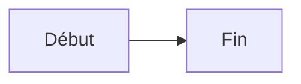

# Titre un

Un paragraphe avec **gras**, *italique*, `code` et un lien [[Cible]].
Deuxième ligne du même paragraphe.

## Titre deux ^ancre

- Élément un
- Élément deux
  - Sous-élément a
  - Sous-élément b
    - Niveau trois
- Élément trois

- [ ] Tâche ouverte
- [x] Tâche faite
- [ ] Autre tâche #todo

| Colonne A | Colonne B |
|-----------|-----------|
| 1         | 2         |
| 3         | 4         |

```bash
echo "bloc de code"
ls -la
```

> [!warning] Attention
> Corps de l'appel
> sur deux lignes

> Une citation simple
> sur deux lignes



$$
E = mc^2
$$

![[pic.png|200]]

{{#include Cible.md}}

Texte avec une note[^1] de bas de page.

[^1]: Définition de la note de bas de page.

<details>
<summary>Un repli</summary>

Paragraphe dans le repli.

- liste dans le repli

</details>

````tabs

tab: Alpha

Texte de l'onglet Alpha.

```bash
echo alpha
```

tab: Beta

### Titre caché dans Beta

Texte de l'onglet Beta.

````

{{#tabs}}
{{#tab name="Rust"}}
Texte Rust.
{{#endtab}}
{{#tab name="C"}}
Texte C.
{{#endtab}}
{{#endtabs}}

Dernier paragraphe.
